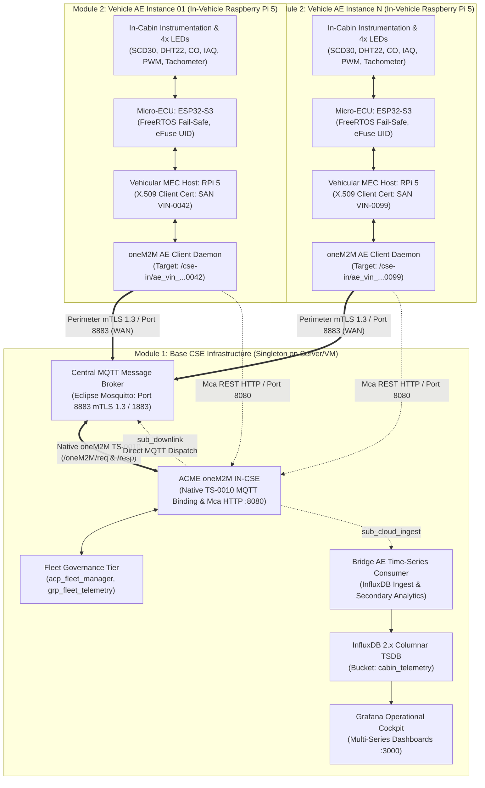

# System Design Specification: Modular Base CSE and Multi-Instance Vehicle AE Architecture

**Document ID:** SDS-SDV-MODULAR-001  
**Version:** 2.1.0 (Physical Host Allocation & Consolidated Vehicular Edge Gateway Architecture)  
**Status:** Approved Technical Architecture  
**Project:** Software-Defined Vehicle (SDV) Automotive IoT Cabin Monitoring & HVAC Regulation  
**Standard Compliance:** ETSI TS 118 101 Rel 4, oneM2M TS-0001, oneM2M TS-0003, oneM2M TS-0004, oneM2M TS-0010 (MQTT Protocol Binding)  
**Associated Baseline:** [acme_cse_gateway_capability_review.md](file:///home/mosud/Documents/dev/HVAC-iot-monitoring/foundational_document/acme_cse_gateway_capability_review.md)  
**Academic Affiliation:** University of Applied Sciences Technikum Wien (FH Technikum Wien)  
**Research Cluster:** Distributed Cyber-Physical Systems and Automotive IoT (FHTW-AIOT, Group MIO3B)  

---

## 1. Executive Summary and Architectural Principles

This specification defines the structural partitioning, physical host allocations, interface contracts, identity-binding protocols, and deployment lifecycle for the SDV Cyber-Physical Environmental Monitoring and Closed-Loop HVAC Regulation platform.

The architecture enforces a strict demarcation between the central infrastructure platform and distributed vehicular edge compute nodes:

1. **Base CSE Infrastructure Module (Singleton Instance — Server / Virtual Machine):**
   * **Host Platform:** Deployed on an external connected device—a **central physical server, cloud instance, or virtual machine (VM)**.
   * **Role:** Serves as the authoritative Common Services Entity (ACME oneM2M IN-CSE), central MQTT message broker (Eclipse Mosquitto terminating perimeter mTLS 1.3), fleet governance policy repository, time-series data lake (InfluxDB 2.x), and fleet-wide operational cockpit (Grafana Enterprise).
   * **Cardinality:** **Strictly a single, authoritative instance per operational cluster ($C = 1$).**

2. **Vehicle Application Entity (AE) Module (Multi-Instance — In-Vehicle Raspberry Pi 5):**
   * **Host Platform:** Deployed **directly onboard each physical vehicle on a dedicated Raspberry Pi 5** single-board computer (vehicular MEC host).
   * **Role:** Interfaced directly with in-cabin physical instrumentation (ESP32-S3 micro-ECU, Sensirion SCD30, DHT22, CO, IAQ/VOC, AQI transducers, 4-channel LED actuator matrix, WS2812B annunciator, and closed-loop tachometer). The Raspberry Pi 5 executes the uniquely identified Application Entity (AE) client daemon, local sensor ingress/pre-processing, mTLS client credentials, and downlink actuation dispatcher.
   * **Cardinality:** **Deployable across $N$ uniquely identified, concurrent, and independent vehicular instances ($i \in \{1, 2, \dots, N\}$).**



---

## 2. Consolidation of Vehicular Edge Gateway Functions into ACME oneM2M CSE

As established in the architectural capability review ([acme_cse_gateway_capability_review.md](file:///home/mosud/Documents/dev/HVAC-iot-monitoring/foundational_document/acme_cse_gateway_capability_review.md)), the platform consolidates legacy edge gateway microservices directly into native ETSI TS 118 101 middleware capabilities.

### 2.1 Excised Microservices and Absorbed Capabilities

1. **Decommissioning of Node-RED Ingress Proxy (`nodered_ipe`):**
   * *Legacy Role:* Acted as an intermediate Node.js container translating raw MQTT topics into HTTP REST `<m2m:cin>` instances, and translating HTTP webhooks into downlink MQTT actuation commands.
   * *Consolidated Architecture:* Completely decommissioned and excised from the deployment mesh. ACME oneM2M IN-CSE natively terminates and dispatches oneM2M primitives over MQTT via **oneM2M TS-0010 MQTT protocol bindings** (`[mqtt]` in `deploy/onem2m/acme.ini`). The vehicle node publishes ContentInstances directly to `/oneM2M/req/...` and receives actuation downlinks on `/oneM2M/req/id-in/{aei}/json`.
   * *Performance Gain:* Reclaims ~220 MB RAM and reduces closed-loop actuation propagation latency by $40\text{--}80\,\text{ms}$.

2. **In-CSE Multi-Hazard Health Classification:**
   * *Legacy Role:* The standalone Python `bridge_ae` microservice evaluated all sensor divergence, stale timestamps, and motor stalls.
   * *Consolidated Architecture:* ACME CSE’s internal scripting engine (`acme-scripts` with `onCreate` hooks) absorbs multi-hazard rule evaluation directly upon ContentInstance creation. The CSE tags `<cin>` resources with semantic labels (`lbl: ["health:FRESH", "delta_t:0.32", "delta_rh:1.8", "stall:false"]`) and raises emergency alarms internally. `bridge_ae` is streamlined into a lightweight, non-blocking time-series persistence consumer.

3. **Edge Time-Series Buffering and Storage Caps:**
   * *Consolidated Architecture:* Rather than running a heavyweight edge TSDB for short-term buffering, ACME CSE enforces standard oneM2M container lifecycle bounds:
     * `mni: 1440`: Buffers 1,440 historical instances (24 hours at 1-minute cadence).
     * `mbs: 2097152`: Strict 2 MB memory-footprint cap protecting vehicular storage.
     * `mia: 86400`: 24-hour automatic TTL instance pruning.
     * `missingDataDetect: true`: Built-in sensor loss detection without custom watchdog daemons.

4. **Dynamic Fleet Group Fan-Out (`<grp>`, `<fopt>`):**
   * *Consolidated Architecture:* Centralised group aggregation allows atomic fleet status queries (`/grp_fleet_telemetry/fopt/la`) and multi-vehicle broadcast actuations without external orchestrator scripts.

5. **Dynamic Semantic Policy Engine (`<acp>`):**
   * *Consolidated Architecture:* Replaces static broker ACL text files with standard oneM2M Access Control Policies, dynamically binding privileges to verified AE-IDs.

### 2.2 Architectural Segregation: Retained Dedicated Platforms

To guarantee cyber-physical safety, cryptographic robustness, and high-performance analytics, specific functions are strictly retained on dedicated platforms outside the CSE:

| Subsystem | Placement | Architectural Rationale |
| :--- | :--- | :--- |
| **Mutual TLS 1.3 Termination** | **Eclipse Mosquitto (Port 8883)** | Cryptographic perimeter security, hardware ECDSA P-256 acceleration, and X.509 client certificate verification must terminate at a hardened C broker, protecting the Python ASGI/WSGI stack. |
| **Long-Term Multi-Series TSDB** | **InfluxDB 2.x Columnar Engine** | High-cardinality nanosecond time-series analytics and Flux queries across months of fleet operation exceed the capacity of oneM2M SQLite/TinyDB metadata backends. |
| **Operational Cockpit** | **Grafana Enterprise (Port 3000)** | Fleet-wide visual observability, multi-series dashboards, dynamic alerting, and operator control cockpits. |
| **Autonomous Safety Overrides** | **ESP32-S3 FreeRTOS Firmware** | Safety-critical fail-safe loops (e.g. 50% baseline purge ventilation during communication loss or CO emergency) execute deterministically in microcontroller firmware independent of edge host or network state. |

---

## 3. Module 1: Base CSE Infrastructure Specification (Singleton on Server / Virtual Machine)

### 3.1 Host Platform and Deployment Topology
* **Host Platform:** Dedicated physical server, cloud instance, or virtual machine (VM) (Linux x86_64 or aarch64 server environment).
* **Singleton Constraint:** Exactly one Base CSE infrastructure instance exists per operational cluster. It operates with a stable, routable network identity (e.g. `GATEWAY_IP=192.168.122.91` or cluster FQDN).
* **Deployment Packaging:** Packaged and deployed via `deploy/docker-compose.yml` on the central host.

### 3.2 Core Component Responsibilities
1. **ACME oneM2M IN-CSE (`sdv_onem2m_cse`):**
   * Exposes standard Mca HTTP(S) reference point on port `8080` and native oneM2M TS-0010 MQTT binding on internal port `1883`.
   * Manages the root `<m2m:cb>` (CSEBase) identified by `cse_id` (`id-in`) and accessible at path `/{{ cse_rn }}` (`/cse-in` or `/sdv-cse`).
   * Enforces semantic schema validation, resource lifecycles, and access control policies.
2. **Fleet Governance Layer (Pre-Provisioned Hierarchy):**
   * **Fleet Access Control Policy (`acp_fleet_manager`):** Establishes default administrative and onboarding privileges.
   * **Fleet Fan-Out Group (`grp_fleet_telemetry`):** An aggregate `<m2m:grp>` whose member IDs (`mid`) dynamically index the raw telemetry containers of all onboarded vehicles. Supports atomic fleet queries via `/grp_fleet_telemetry/fopt/la`.
   * **Downlink & Cloud Ingestion Subscriptions:** Dispatches asynchronous change events to subscriber targets.
3. **Data Health & Storage Pipeline:**
   * **Central Mosquitto Broker (`sdv_mosquitto_broker`):** Terminates network mTLS 1.3 on port 8883 from all vehicular Raspberry Pi 5 nodes.
   * **Bridge AE Time-Series Consumer (`sdv_bridge_ae`):** Consumes `<subscription>` notifications and writes clean records to InfluxDB.
   * **InfluxDB 2.x TSDB (`sdv_influxdb`):** Historical time-series persistence.
   * **Grafana Operational Cockpit (`sdv_grafana`):** Observability and fleet-wide KPI visualisation.

### 3.3 Initial State Guarantee
Upon initial bootstrap, the Base CSE module **must contain zero vehicular Application Entities**. No vehicle node shall be present until dynamically onboarded by an authentic Vehicle AE module running on an in-vehicle Raspberry Pi 5.

---

## 4. Module 2: Vehicle AE Specification (Multi-Instance on In-Vehicle Raspberry Pi 5)

### 4.1 Host Platform and Deployment Topology
* **Host Platform:** Dedicated **Raspberry Pi 5 single-board computer** installed inside each individual vehicle.
* **Multi-Instance Constraint:** For $N$ vehicles in the fleet, $N$ distinct Raspberry Pi 5 units are deployed. Each unit operates completely independently with zero shared local state, executing its own isolated edge runtime.
* **Network Connection to Base CSE:** Connects over vehicular wide-area networks (cellular 4G/5G, road-side Wi-Fi, or vehicular mesh) back to the central Server/VM on port 8883 (mTLS 1.3) and port 8080 (oneM2M Mca).

### 4.2 Physical and Edge Compute Stack
Each in-vehicle Raspberry Pi 5 orchestrates two physical and computational tiers:

#### Tier A: Physical Sensing & Actuation Node (ESP32-S3 Micro-ECU)
* **Hardware Interface to Raspberry Pi 5:** Directly connected via a dedicated physical serial bus (USB-CDC on `/dev/serial/by-id/usb-Espressif_ESP32-S3_...` or hardware GPIO UART) with parity checking.
* **Transducers (7 Environmental Channels):**
  * Sensirion SCD30: NDIR $\text{CO}_2$ (0–10,000 ppm), dry-bulb temperature, relative humidity over $\text{I}^2\text{C}$ Fast-Mode (400 kHz) with hardware CRC-8 verification.
  * DHT22: Redundant temperature and relative humidity over 1-Wire bus with parity checksum.
  * Carbon Monoxide (CO) Sensor: Toxic gas detection (0–1,000 ppm) with emergency alert interrupt.
  * Cabin Air Quality (IAQ/VOC): Volatile organic compound index (0–500) for passenger air quality.
  * Exterior Air Quality (AQI): Ambient outdoor index for fresh-air intake vs cabin air recirculation damper control ($\Delta IAQ$).
* **Actuators (4-Channel Emulation Matrix & Closed-Loop Tachometer):**
  * Blue LED (GPIO 18): Purge blower ventilation driven at 25.0 kHz PWM with 10-bit resolution ($0\text{--}100\%$ duty cycle).
  * Red LED (GPIO 17): Auxiliary cabin PTC heating core driven by digital output ($T_{\text{cabin}} < 19.0\,^\circ\text{C}$).
  * Green LED (GPIO 16): Baseline eco-ventilation driven by digital output (nominal air quality).
  * Amber LED (GPIO 15): Dehumidification and warning alert driven by digital output ($RH > 65\%$ or degraded data health).
  * WS2812B RGB LED (GPIO 38): Optical state annunciator indicating network, sensor, and safety status.
  * Hall-Effect Tachometer Feedback (GPIO 19): Interfaced via Pulse Counter (PCNT) Unit 0 for closed-loop blower stall detection.
* **Firmware Runtime:** FreeRTOS with strict core affinity (Core 1: Sensor/PWM loop; Core 0: mTLS/Network loop).
* **Hardware Identity:** Immutable 48-bit MAC address and 128-bit UID read from write-once eFuse registers.

#### Tier B: Vehicular MEC Host (Raspberry Pi 5)
* **Compute Platform:** Quad-core ARM Cortex-A76 vehicular edge host running vehicular Linux.
* **Local Ingress & Formatting Agent:** Ingests raw telemetry frames from the ESP32-S3, verifies CRC-8/parity checksums, and serialises valid oneM2M JSON content instances.
* **Cryptographic Identity Vault:** Securely stores the vehicle's unique ISO 3779 VIN, OTP board serial, and private key/X.509 client certificate for mTLS 1.3 authentication against the central server/VM.
* **oneM2M AE Client Agent:** Executes the onboarding reconciliation loop, periodic telemetry transmission to the Base CSE via native TS-0010 MQTT or Mca REST, and actuation downlink command dispatch to the ESP32-S3.

### 4.3 Dynamic oneM2M Resource Representation
When a vehicle's Raspberry Pi 5 registers with the Base CSE on the server/VM, it provisions a dedicated subtree under `<m2m:cb>`:

```text
/cse-in (CSEBase on Server/VM)
 └── ae_vin_wauzzz_sdv_2026_0042 (Application Entity: <m2m:ae> deployed on RPi 5)
      ├── temperature-cabin (Container: <m2m:cnt>)
      ├── humidity-cabin (Container: <m2m:cnt>)
      ├── co2-cabin (Container: <m2m:cnt>)
      ├── co-cabin (Container: <m2m:cnt>)
      ├── air-quality-cabin (Container: <m2m:cnt>)
      ├── air-quality-exterior (Container: <m2m:cnt>)
      ├── raw-telemetry (Container: <m2m:cnt>)
      │    ├── cin_xxxx (<m2m:cin>)
      │    └── sub_cloud_ingest (<m2m:sub>)
      └── commands (Container: <m2m:cnt>)
           └── sub_downlink_actuation (<m2m:sub>)
```

---

## 5. Multi-Layer Binding Mechanism: Uniquely Linking Vehicle to AE

To guarantee that each physical vehicle solely and accurately links to its designated AE instance on the Base CSE without cross-talk or collision, the 5-layer binding mechanism operates across the module boundary:

| Layer | Binding Mechanism | Implementation Across Physical Hosts |
| :--- | :--- | :--- |
| **1. Physical Hardware** | ESP32 eFuse MAC + RPi 5 Board Serial $\to$ ISO 3779 VIN | **In-Vehicle RPi 5:** Embedded in local device tree and sensor frame headers. |
| **2. Transport Security** | X.509 Mutual TLS 1.3 with Subject Alternative Name (SAN) | **Network Boundary:** RPi 5 presents client cert with `SAN: URI:urn:sdv:vin:<VIN>`. Server/VM gateway authenticates cert against vehicular Root CA. |
| **3. Semantic Identity** | Deterministic Resource Name ($rn = \text{FNV-1a}(\text{VIN})$) | **Middleware Boundary:** RPi 5 registers/reconciles deterministic $rn$. Server/VM Base CSE binds allocated $aei$ to client credential. |
| **4. Access Control** | Dedicated `<m2m:acp>` per vehicle ($acop = 63$ for $aei$) | **Server/VM Base CSE:** Restricts CRUD operations on `/ae_vin_<slug>/*` strictly to that vehicle's authenticated $aei$ and $CAdmin$. |
| **5. Downlink Routing** | Targeted Point of Access ($poa$) & MQTT topics | **Network Boundary:** Actuator directives route strictly to `sdv/{vin}/control/cmd` or native topic `/oneM2M/req/id-in/{aei}/json`. |

### 5.1 Deterministic Resource Name Equation
To prevent collisions and eliminate hardcoded aliases, the AE Resource Name is mathematically derived from the vehicle's unique identity string:

$$rn_{\text{AE}} = \texttt{ae\_vin\_} \,\|\, \operatorname{slugify}(\text{VIN}) \,\|\, \texttt{\_} \,\|\, \operatorname{hex}\left(\operatorname{FNV-1a}_{32}(\text{VIN})\right)$$

This guarantees:
1. **Uniqueness:** Two distinct vehicles ($VIN_A \ne VIN_B$) yield distinct resource names ($rn_A \ne rn_B$).
2. **Idempotence:** A rebooting vehicle always resolves the exact same resource name, eliminating duplicate "ghost" AEs.

---

## 6. Multi-Dimensional Data Health Classification Engine

The system evaluates incoming sensor telemetry against five quantitative health criteria:

$$\Delta T = |T_{\mathrm{SCD30}} - T_{\mathrm{DHT22}}| \le 1.5\,^\circ\text{C}$$
$$\Delta RH = |RH_{\mathrm{SCD30}} - RH_{\mathrm{DHT22}}| \le 10.0\,\%$$
$$\tau_{\mathrm{age}} = t_{\mathrm{eval}} - t_{\mathrm{sample}} \le 2.5\,\text{s}$$
$$\text{Stall Fault} \iff (\text{PWM} \ge 30\%) \land (\text{RPM} < 100)$$
$$\text{Toxic Gas Hazard} \iff \text{CO} \ge 30.0\,\text{ppm}$$

### Categorical State Assignment
1. **`FRESH`:** $\tau_{\text{age}} \le 2.5\,\text{s}$, $\Delta T \le 1.5\,^\circ\text{C}$, $\Delta RH \le 10\%$, and tachometer feedback confirmed. Full closed-loop regulation active.
2. **`STALE`:** $2.5\,\text{s} < \tau_{\text{age}} \le 10.0\,\text{s}$. Network latency delay; hold-last-valid-value regulation logic engaged.
3. **`DEGRADED`:** $\Delta T > 1.5\,^\circ\text{C}$ or $\Delta RH > 10.0\%$. Transducer divergence; amber annunciator illuminated; system relies on conservative SCD30 readings.
4. **`FAULT`:** $\tau_{\text{age}} > 10.0\,\text{s}$, null reading, out-of-bounds reading, or blower motor stall detected. Numerical values excluded from time-series aggregates; blower defaults to 50% baseline fail-safe ventilation.

---

## 7. Deployment and Operational Scenarios

### 7.1 Scenario A: Singleton Base CSE Bootstrap (Server / Virtual Machine)
1. The cloud or server infrastructure deploys `deploy/docker-compose.yml` on the Server/VM.
2. `sdv_onem2m_cse`, `sdv_mosquitto_broker`, `sdv_bridge_ae`, `sdv_influxdb`, and `sdv_grafana` initialize (Node-RED is decommissioned).
3. The Base CSE governance bootstrap script (`deploy_acme_fleet_cse_base.py`) executes:
   * Verifies CSEBase reachability (`GET /cse-in`).
   * Provisions `acp_fleet_manager` (<m2m:acp>).
   * Provisions `grp_fleet_telemetry` (<m2m:grp>) with an empty member array (`mid = []`).
   * **Result:** Clean, production-ready Base CSE with zero registered vehicle AEs.

### 7.2 Scenario B: Commissioning a New Vehicle AE Instance (In-Vehicle Raspberry Pi 5)
Each physical vehicle executes its onboarding sequence independently from its onboard Raspberry Pi 5:
1. **Hardware Power-On:** ESP32 boots FreeRTOS, begins sensor sampling, and establishes local bus communication with the Raspberry Pi 5.
2. **Identity Resolution:** Raspberry Pi 5 agent reads local VIN and computes deterministic $rn_{\text{AE}}$.
3. **Reconcile-on-Boot Check:**
   * Raspberry Pi 5 issues `GET /cse-in/{{ vehicle_ae_rn }}` over WAN to the Server/VM with `X-M2M-Origin: CAdmin` (or authenticated client cert).
   * **Branch 1 (New Vehicle - 404 Not Found):**
     * Issues `POST /cse-in` with `ty=2` to create `<m2m:ae>` using deterministic $rn$.
     * Iterates through the canonical sensor manifest to create the 8 standard containers (`<m2m:cnt>`).
     * Attaches downlink subscription to `/commands`.
     * Registers its `raw-telemetry` container in Base CSE's `grp_fleet_telemetry.mid`.
   * **Branch 2 (Reconnecting Vehicle - 200 OK):**
     * Validates existing container tree.
     * Reclaims its assigned `aei` and immediately resumes telemetry commits.
4. **Steady-State Ingestion:** Raspberry Pi 5 posts telemetry instances (`<m2m:cin>`) via native oneM2M TS-0010 MQTT or Mca REST directly to its own `/raw-telemetry` container on the Server/VM.

### 7.3 Scenario C: Decommissioning / Retiring a Vehicle AE Instance
When a vehicle is decommissioned or retired from the fleet:
1. Administrative command or vehicle departure agent issues `DELETE /cse-in/{{ vehicle_ae_rn }}` against the Server/VM.
2. Base CSE cascade-deletes the vehicle's `<m2m:ae>`, all 8 child `<m2m:cnt>` containers, all `<m2m:cin>` records, and subscriptions.
3. Governance reconciliation script removes the deleted container URI from `grp_fleet_telemetry.mid`.
4. Other active vehicle AE instances running on other Raspberry Pi 5 units remain entirely unaffected.

---

## 8. Environment and Configuration Contracts

### 8.1 Base CSE Server / VM Environment (`deploy/.env`)
The Base CSE host maintains infrastructure-wide variables:
```dotenv
# Infrastructure & Gateway Addressing
GATEWAY_IP=192.168.122.91
ONEM2M_PORT=8080
ONEM2M_CSE_ID=id-in
ONEM2M_CSE_NAME=cse-in

# Security & Governance
BASE_CSE_ADMIN_ORIGINATOR=CAdmin
FLEET_ACP_NAME=acp_fleet_manager
FLEET_GROUP_NAME=grp_fleet_telemetry

# Service Endpoints
MOSQUITTO_PORT=8883
INFLUXDB_HOST_PORT=8087
GRAFANA_PORT=3000
```

### 8.2 In-Vehicle Raspberry Pi 5 Environment (`vehicle/.env` per vehicle)
Each physical vehicle host maintains its local instance parameters:
```dotenv
# Vehicle Hardware & Cryptographic Identity
VEHICLE_VIN=VIN-WAUZZZ-SDV-2026-0042
VEHICLE_NODE_ID=sdv-car-0042
CLIENT_CERT_PATH=/etc/sdv/certs/client.crt
CLIENT_KEY_PATH=/etc/sdv/certs/client.key

# Target Central Base CSE Server / VM Connection
BASE_URL=http://192.168.122.91:8080
CSE_RN=cse-in
ORIGINATOR=CAdmin
APP_ID=N.org.fhtw.sdv.cabin
RVI=3

# Local In-Vehicle Instrumentation Configuration
LOCAL_ESP32_PORT=/dev/serial/by-id/usb-Espressif_ESP32-S3_001
DOWNLINK_NOTIFICATION_URL=mqtt://192.168.122.91:8883/oneM2M/req/id-in/C_ae_vin_wauzzz_0042/json
```

---

## 9. Quality Attributes and Verification Matrix

| Quality Attribute | Requirement Specification | Verification Method |
| :--- | :--- | :--- |
| **Singleton Guarantee** | Exactly one Base CSE exists per network domain on the Server/VM. Zero duplicate CSEBase roots permitted. | Unit & integration test `make validate-base-cse` verifying singular `<m2m:cb>`. |
| **AE Scalability** | Fleet capacity scales to $N$ independent vehicle AEs on distributed Raspberry Pi 5 units without code modifications. | Iterative test harness executing onboarding for $M$ arbitrary VINs. |
| **Collision Immunity** | Two vehicles with different VINs must never claim or overwrite the same AE tree on the Base CSE. | Ingestion collision test asserting HTTP 409 / 403 on duplicate registration attempts. |
| **Zero Initial State** | Fresh deployment of Base CSE on the Server/VM must start with zero vehicular AEs. | Preflight audit confirming `len(cb.childResource[ty==2]) == 0`. |
| **Native Ingestion** | Zero intermediary proxy containers; native oneM2M TS-0010 MQTT / Mca HTTP. | Integration test verifying Node-RED absence and direct primitive routing. |
| **Fail-Safe Containment**| Network disconnection of Vehicle $A$'s Raspberry Pi 5 has zero impact on Vehicle $B$'s ingestion loop. | Network fault injection testing with `inject_faults.py`. |
