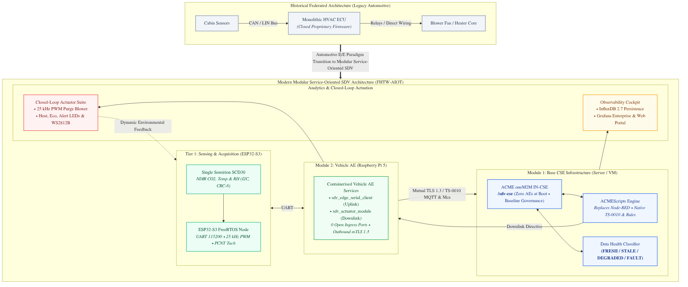
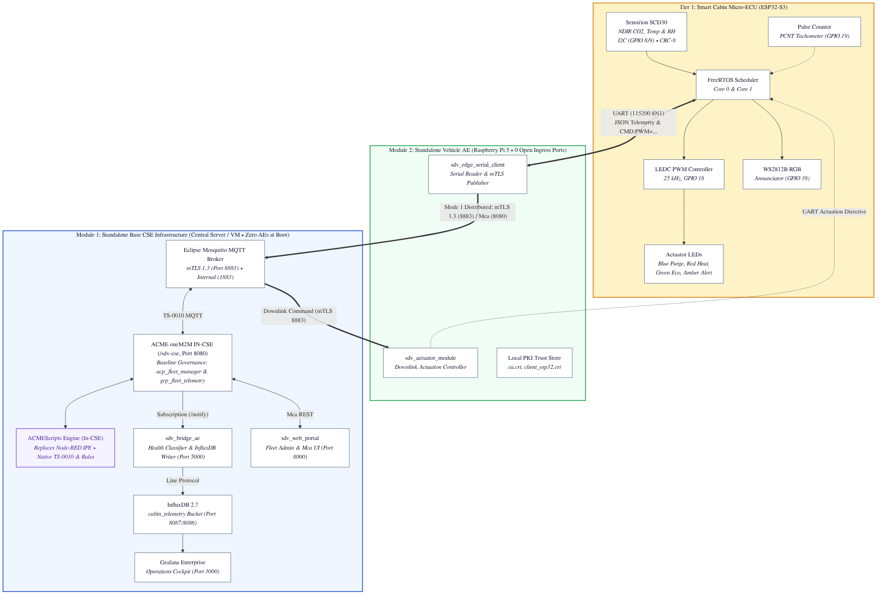
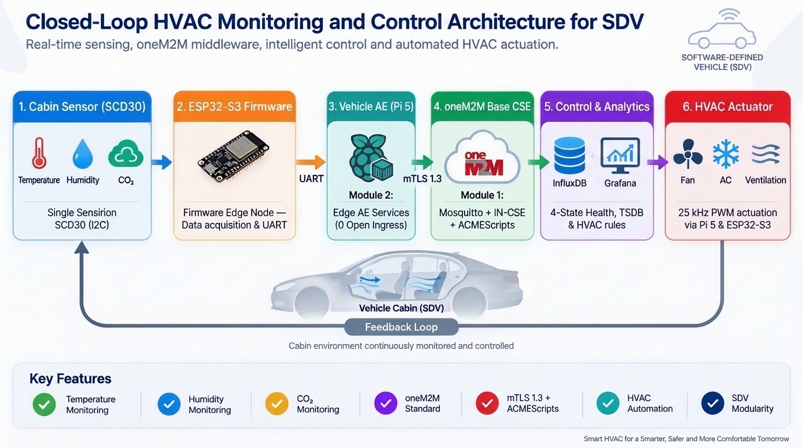
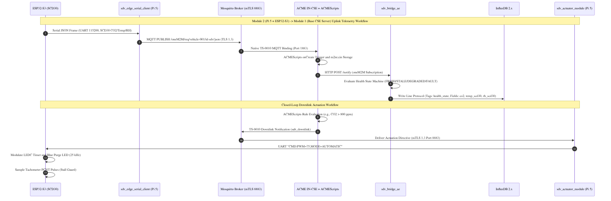
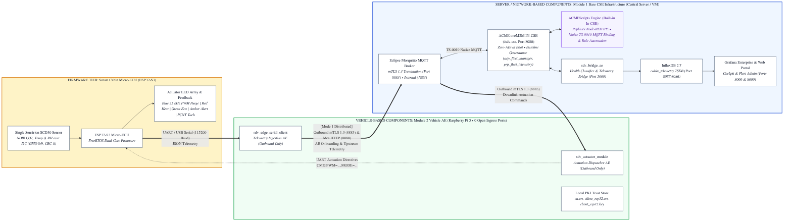

# 03. System Architecture Document (SAD)

## Software-Defined Vehicle (SDV) Cyber-Physical Cabin Environmental Monitoring and Closed-Loop HVAC Regulation System

---

## Document Control & Attribution

| Attribute | Specification Detail |
| :--- | :--- |
| **Document Designation** | System Architecture Document (SAD) |
| **Project Title** | Cyber-Physical Cabin Environmental Monitoring & Closed-Loop HVAC Regulation in Software-Defined Vehicles |
| **Researcher & Architecture** | **Isiaka Mosudi** (Middleware & Distributed Systems Architecture) |
| **Research Team** | **Isiaka Mosudi**, Ashok Ramalingam, Pooja Janwalkar, AnnaMaria Moçi, Julia Philip |
| **GitHub Repository** | [https://github.com/imosudi/HVAC-iot-monitoring](https://github.com/imosudi/HVAC-iot-monitoring) |
| **Status & Compliance** | Released / Verified (ISO/IEC/IEEE 42010, ETSI GS MEC 003, ETSI TS 118 101) |

---

## 1. Architectural Evolution: Monolithic to Service-Oriented SDVs
Historically, automotive climate control has been implemented as a closed, federated subsystem. A dedicated HVAC ECU communicated over isolated Controller Area Network (CAN) or Local Interconnect Network (LIN) buses, hardwired to thermistors, blend door actuators, and blower motor relays. This monolithic design suffers from critical structural shortcomings:
1. **Proprietary Rigidity:** Sensor data and control heuristics remain siloed within OEM firmware, preventing cross-domain telemetry fusion (e.g., driver biometrics or navigation-based pre-conditioning).
2. **Inflexible Lifecycle Management:** Firmware updates require dealer service interventions or dangerous monolithic ECU flashing over UDS.
3. **Absence of Semantic Interoperability:** Sensor values exist as raw binary CAN signals without standardised data typing, ontological definitions, or security assertions.

The SDV paradigm transforms this architecture into a **service-oriented cyber-physical continuum**:
- Physical transducers interface with low-power micro-ECUs (Espressif ESP32-S3) executing deterministic FreeRTOS real-time operating systems.
- Telemetry is transported over an automotive edge service mesh hosted on a vehicular gateway (Raspberry Pi 5) secured via **Mutual TLS 1.3** and strict topic-based Access Control Lists (ACLs).
- Semantic normalisation is performed using an **ETSI oneM2M Common Services Entity (IN-CSE: `/sdv-cse`)**, establishing vendor-neutral resource trees.
- Telemetry integrity is continuously certified by a deterministic **4-state Data Health Classifier** (`FRESH`, `STALE`, `DEGRADED`, `FAULT`), feeding into an InfluxDB 2.x time-series store and triggering closed-loop actuation dispatch through a Grafana operations cockpit and custom management portal.

---

## 2. End-to-End Cyber-Physical Topology
The platform implements an end-to-end, multi-tier cyber-physical topology distributed across three physical host environments:
1. **Tier 1: Smart Cabin Sensing & Actuation Node (Micro-ECU):** Espressif ESP32-S3 microcontroller directly interfacing with physical transducers (Sensirion SCD30, DHT22) and actuator emulation circuits (Blue PWM Purge LED, Red Heat LED, Green Eco LED, Amber Alert LED).
2. **Tier 2: Vehicular Edge Gateway (In-Vehicle Compute):** Raspberry Pi 5 single-board computer hosting the **Vehicle Application Entity (AE) microservices stack** (`sdv_edge_serial_client`, `sdv_actuator_module`, and local serial bus listeners).
3. **Tier 3: Base CSE Infrastructure Platform (Central Server / VM):** High-availability server hosting the **ACME oneM2M Common Services Entity (`/sdv-cse`)**, Eclipse Mosquitto mTLS broker, `sdv_bridge_ae` data health service, InfluxDB 2.x time-series engine, Grafana operations cockpit, and `sdv_web_portal`.

---

## 3. Architectural Decomposition & Layering Patterns
The platform adheres strictly to the Layered Architecture Pattern across five discrete operational tiers:
1. **Perception & Transduction Layer:** Direct physical acquisition via calibrated sensors operating under strict hardware bounds.
2. **Ingress, Protocol Adaptation & Transport Layer:** Encapsulation of UART frames into MQTT v5.0/v3.1.1 frames secured via TLS 1.3, verified against JSON schemas.
3. **Semantic Middleware Layer:** ETSI oneM2M resource tree hierarchy providing RESTful CRUDN operations, persistent resource addressing, and subscription dispatch.
4. **Data Health & Analytics Layer:** Deterministic piecewise state machine execution, psychrometric drift tracking, and high-frequency time-series persistence.
5. **Presentation & Supervisory Operations Layer:** Web dashboards, real-time gauges, and interactive TUI consoles facilitating operational diagnostics and manual override dispatch.

---

## 4. Microservice Mesh and Containerisation Pattern
Except for the ESP32-S3 firmware, all system services are packaged as hardened Docker containers linked through an isolated Docker bridge network (`sdv_mec_mesh`) on the Base CSE platform, and host networking on the edge vehicle gateway to permit native access to serial USB controllers (`/dev/ttyUSB0` or `/dev/ttyACM0`).

---

## 5. Multi-Access Edge Computing & Fog Interworking
The architecture adheres to the Multi-Access Edge Computing (ETSI GS MEC 003) pattern. The in-cabin gateway performs local frame buffering and validation. If the backhaul wireless uplink to the Base CSE platform suffers intermittent attenuation or complete severance, the edge gateway caches up to $48\text{ hours}$ of historical telemetry, whilst the Micro-ECU maintains autonomous closed-loop failsafe regulation without cloud dependency.

---

## 6. Closed-Loop Feedback Control Trajectory

The primary cyber-physical feedback loop regulates cabin air quality dynamically:
1. **Sensing:** SCD30 samples $\text{CO}_2$, $T$, and $\text{RH}$ every $2\text{ seconds}$; DHT22 samples $T$ and $\text{RH}$ concurrently.
2. **Uplink Dispatch:** Micro-ECU serialises readings into JSON and pushes them across UART to the edge gateway.
3. **Transport & Ingress:** `sdv_edge_serial_client` transmits the payload across MQTT (mTLS 1.3) to Mosquitto.
4. **Semantic Registration:** Node-RED IPE ingests the MQTT frame, wraps it into an `<m2m:cin>` resource, and posts it to `/sdv-cse/AE_CabinNode_Car01/cnt_raw_telemetry`.
5. **Health Certification:** oneM2M fires an HTTP webhook notification to `sdv_bridge_ae`. The classifier confirms data validity ($|T_{scd30} - T_{dht22}| \le 1.5^\circ\text{C}$, $\text{Age} \le 2.5\text{s}$) and marks the record as `FRESH`.
6. **Persistence:** The classified frame is stored in InfluxDB 2.x.
7. **Control Decision:** If $\text{CO}_2 > 800\text{ ppm}$, an actuation directive is issued. If $\text{CO}_2 > 1{,}200\text{ ppm}$, high-speed emergency purge is commanded (`PWM = 100%`).
8. **Downlink Dispatch:** A new `<m2m:cin>` is created in `/sdv-cse/AE_CabinNode_Car01/cnt_actuation_cmd`.
9. **Actuation Notification:** oneM2M notifies Node-RED, which publishes a control frame to `sdv/vehicle_01/control/cmd`.
10. **Actuation Modulation:** `sdv_actuator_module` receives the command and issues `CMD:PWM=100,MODE=AUTOMATIC` to the ESP32-S3, which ramps the Blue Purge LED to 100% duty cycle, opens the fresh air damper, and monitors tachometer RPM to confirm fan rotation.

---

## 7. End-to-End Sequence Workflows

---

## 8. Multi-Host Network Topologies
The architecture supports dual operational configurations:
- **Scenario A (Consolidated Dev Stack):** All microservices co-located on a single host (`127.0.0.1`), interfacing with the ESP32-S3 over local USB.
- **Scenario B (Distributed Production Topology):** Multi-host physical partitioning:
  - **Host 1 (Central Server / VM):** Base CSE Infrastructure Platform (ACME IN-CSE, Mosquitto mTLS Broker, InfluxDB 2.7, Grafana Enterprise, Bridge AE, Web Portal).
  - **Host 2 (In-Vehicle Edge Gateway - Raspberry Pi 5):** Vehicle AE Microservices Stack (`edge_serial_client`, `actuator_module`).
  - **Host 3 (Smart Cabin Node):** ESP32-S3 connected to Raspberry Pi 5 via internal USB/UART.

