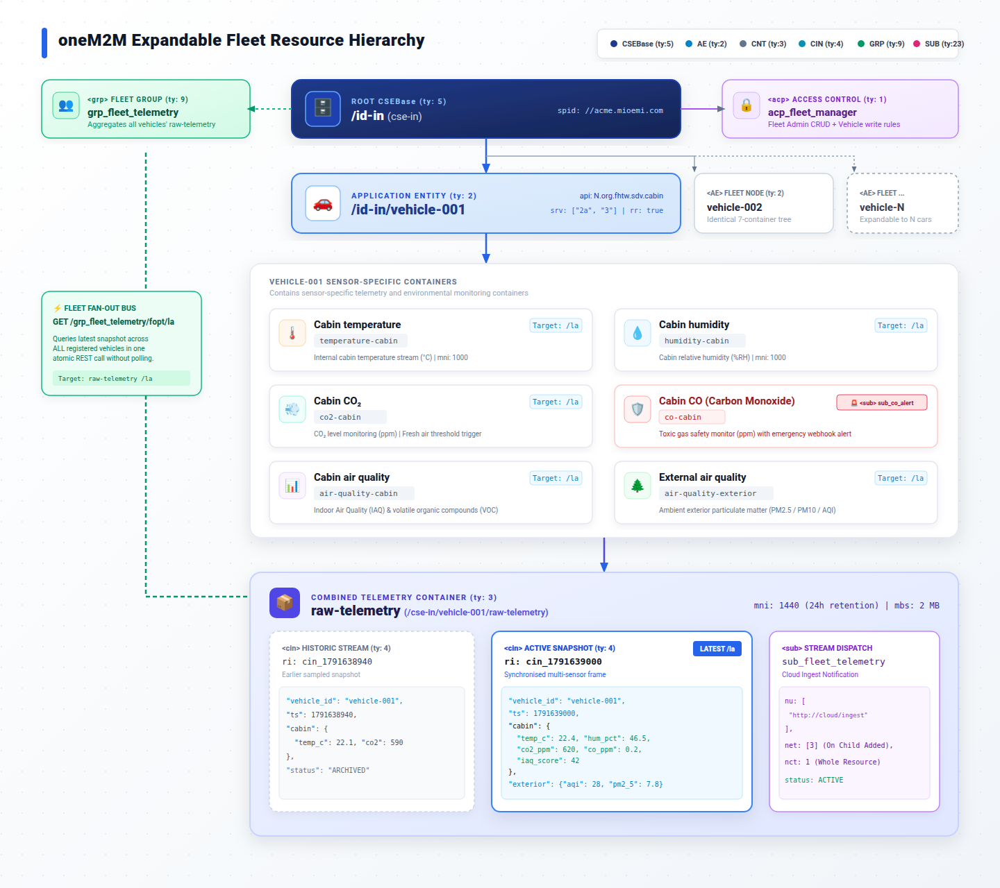

# 04. Domain Model Specification (DMS)

## Software-Defined Vehicle (SDV) Cyber-Physical Cabin Environmental Monitoring and Closed-Loop HVAC Regulation System

---

## Document Control & Attribution

| Attribute | Specification Detail |
| :--- | :--- |
| **Document Designation** | Domain Model Specification (DMS) |
| **Project Title** | Cyber-Physical Cabin Environmental Monitoring & Closed-Loop HVAC Regulation in Software-Defined Vehicles |
| **Researcher & Architecture** | **Isiaka Mosudi** (Middleware & Distributed Systems Architecture) |
| **Research Team** | **Isiaka Mosudi**, Ashok Ramalingam, Pooja Janwalkar, AnnaMaria Moçi, Julia Philip |
| **GitHub Repository** | [https://github.com/imosudi/HVAC-iot-monitoring](https://github.com/imosudi/HVAC-iot-monitoring) |
| **Status & Compliance** | Released / Verified (ETSI TS 118 101, oneM2M TS-0001) |

---

## 1. ETSI oneM2M Semantic Resource Tree Information Model
Adhering to ETSI TS 118 101, vehicular telemetry and control directives are structured within an explicit, hierarchical semantic resource tree hosted by the ACME oneM2M Common Services Entity:



The formal resource structure comprises:
- **`<m2m:cb>` (CSEBase: `/sdv-cse`, `ty=5`):** Root service anchor.
- **`<m2m:acp>` (AccessControlPolicy: `acp_cabin_node`, `ty=1`):** Governs originators and privileges.
- **`<m2m:ae>` (ApplicationEntity: `AE_CabinNode_Car01`, `ty=2`, `aei="C_CabinNode_Car01"`):** Represents the vehicle instance.
- **`<m2m:cnt>` (Containers, `ty=3`):**
  - `cnt_raw_telemetry` (`mni = 1000`, `mbs = 1048576`): Ingress telemetry instances.
  - `cnt_data_health` (`mni = 1000`): Certified health records and drift metrics.
  - `cnt_actuation_cmd` (`mni = 100`): Downlink actuation setpoints.
- **`<m2m:cin>` (ContentInstance, `ty=4`):** Immutable time-stamped JSON data records.
- **`<m2m:sub>` (Subscription, `ty=23`):**
  - `sub_bridge_ae` (`nu = "http://bridge_ae:5000/notify"`): Webhook notifying Bridge AE upon telemetry ingress.
  - `sub_actuator_downlink` (`nu = "http://nodered:1880/downlink"`): Webhook notifying Node-RED upon actuation creation.
- **`<m2m:grp>` (Group, `ty=9`):** Fleet aggregation anchor (`grp_fleet_telemetry`) enabling simultaneous queries across multiple vehicle nodes.

---

## 2. Mathematical Domain Models: Cabin Respiration and Psychrometrics

### 2.1 Metabolic Respiration and Gas Dynamics
In confined passenger compartments with recirculated air, passenger respiration causes exponential $\text{CO}_2$ buildup:

$$\mathrm{C_6H_{12}O_6} + 6\,\mathrm{O_2} \longrightarrow 6\,\mathrm{CO_2} + 6\,\mathrm{H_2O} + \Delta H$$

The dynamic concentration $C_{co2}(t)$ is governed by the compartment mass balance differential equation:

$$V_{cabin} \frac{dC_{co2}(t)}{dt} = N_{occ} \cdot \dot{V}_{exhale} - Q_{vent}(t) \cdot (C_{co2}(t) - C_{ambient})$$

Where:
- $V_{cabin} \approx 3.0\text{ m}^3$ is the effective cabin air volume.
- $N_{occ}$ is the number of passengers.
- $\dot{V}_{exhale} \approx 0.005\text{ L/s}$ is the average metabolic $\text{CO}_2$ generation rate per adult.
- $Q_{vent}(t)$ is the volumetric fresh air ventilation flow rate controlled by the PWM purge blower.

Under steady ventilation $Q_{vent}$, the step accumulation trajectory resolves to:

$$C_{co2}(t) = C_{ambient} + \frac{N_{occ} \cdot \dot{V}_{exhale}}{Q_{vent}}\left(1 - e^{-\frac{Q_{vent}}{V_{cabin}} t}\right)$$

### 2.2 Psychrometric Dew Point Formulation
To evaluate window fogging risk, the platform calculates dew point temperature ($T_{dp}$) from dry-bulb temperature ($T$) and relative humidity ($\text{RH}$):

$$T_{dp} \approx T - \left(\frac{100 - \text{RH}}{5}\right)$$

When cabin relative humidity spikes while window surface temperatures drop below $T_{dp}$, catastrophic windshield fogging occurs. The SDV platform solves this by triggering active dehumidification when $\text{RH} > 70\%$.

### 2.3 Thermal Flux Derivative
Thermal trajectories are evaluated dynamically to compute rate of cabin temperature change ($dT_{cabin}/dt$):

$$\frac{dT_{cabin}}{dt} = \frac{T_{cabin}(k) - T_{cabin}(k-1)}{t_k - t_{k-1}}$$

---

## 3. InfluxDB 2.x Time-Series Storage Domain Model & Line Protocol
Data points are committed to InfluxDB bucket `cabin_telemetry` under measurement `cabin_telemetry`.
- **Measurement:** `cabin_telemetry`
- **Tag Set (Indexed):**
  - `car_id`: Vehicle identifier (e.g., `vehicle_01`)
  - `zone`: Compartment zone (`cabin_front`, `cabin_rear`, `cargo_trunk`)
  - `health_state`: State machine evaluation (`FRESH`, `STALE`, `DEGRADED`, `FAULT`)
  - `simulation`: Boolean (`true` / `false`)
- **Field Set (Unindexed Numeric Metrics):**
  - `co2_ppm`: Float ($\text{CO}_2$ concentration)
  - `temp_scd30_c`: Float (Primary dry-bulb temperature)
  - `rh_scd30_pct`: Float (Primary relative humidity)
  - `temp_dht22_c`: Float (Redundant dry-bulb temperature)
  - `rh_dht22_pct`: Float (Redundant relative humidity)
  - `delta_t_c`: Float ($|T_{scd30} - T_{dht22}|$)
  - `delta_rh_pct`: Float ($|\text{RH}_{scd30} - \text{RH}_{dht22}|$)
  - `tau_latency_s`: Float (Ingress age)
  - `dt_cabin_dt`: Float (Cabin thermal derivative)
  - `actuator_pwm_pct`: Integer (Commanded duty cycle)
  - `actuator_tacho_rpm`: Integer (Observed rotational speed)

**Example InfluxDB Line Protocol:**
```text
cabin_telemetry,car_id=vehicle_01,zone=cabin_front,health_state=FRESH,simulation=false co2_ppm=620.5,temp_scd30_c=22.40,rh_scd30_pct=46.5,temp_dht22_c=22.60,rh_dht22_pct=47.1,delta_t_c=0.20,tau_latency_s=0.45,actuator_pwm_pct=25i,actuator_tacho_rpm=750i 1791639000000000000
```

---

## 4. Non-Coercion Telemetry Philosophy & Missing Data Semantics
A fundamental design flaw in traditional IoT architectures is coercing missing or corrupt sensor readings into `0.0` or synthetic averages. In automotive climate control, coercing a missing temperature reading to $0.0^\circ\text{C}$ causes the HVAC controller to engage maximum cabin heating, risking severe passenger discomfort or electrical fire.

The SDV platform enforces a strict **non-coercion policy**:
- If a sensor line is severed or returns an $\text{I}^2\text{C}$ bus timeout, the value is serialised as JSON `null`.
- The Data Health Classifier flags the record as `FAULT`.
- Downlink control loops immediately drop to a **failsafe baseline** without attempting to regulate against synthetic numbers.
