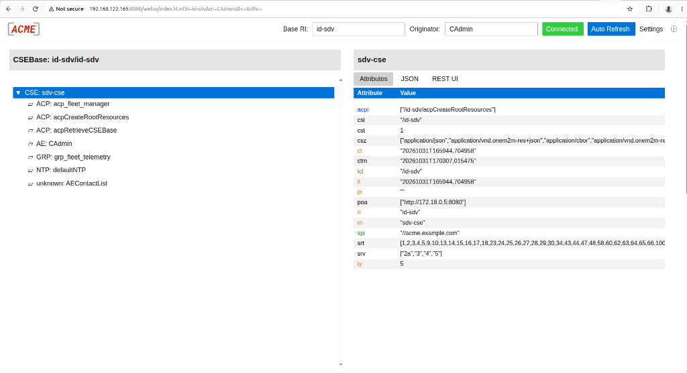
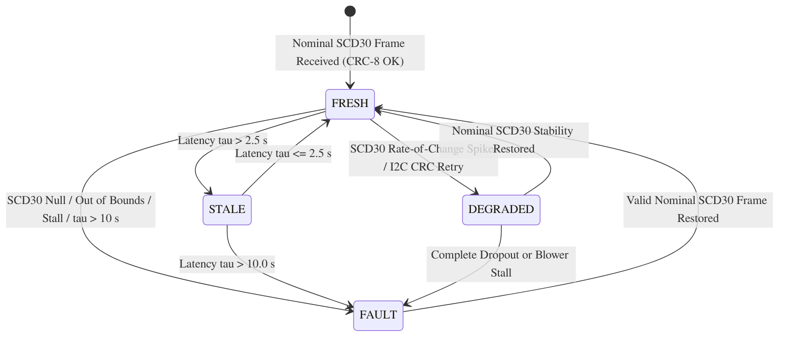
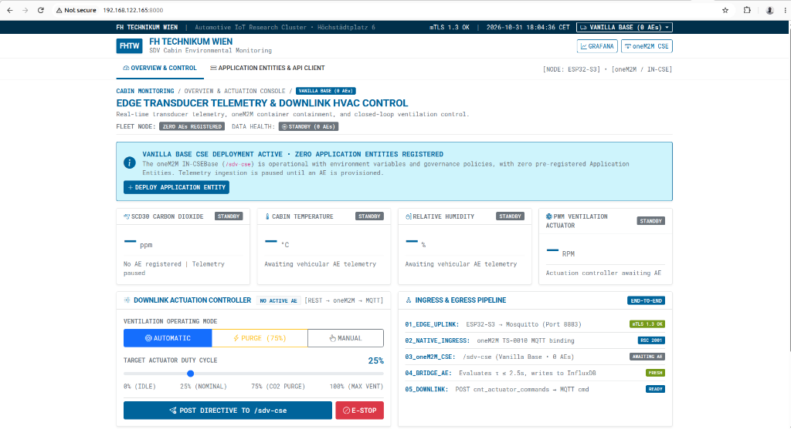
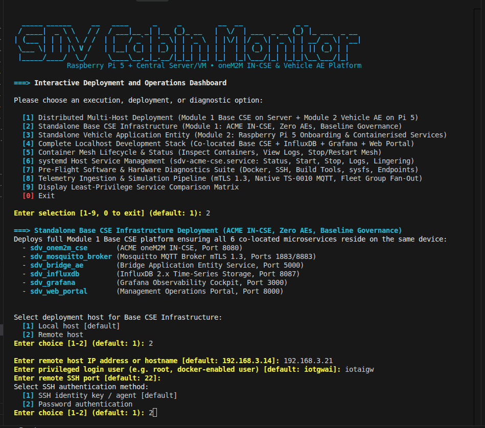

# 05. Service Specification (SS)

## Software-Defined Vehicle (SDV) Cyber-Physical Cabin Environmental Monitoring and Closed-Loop HVAC Regulation System

---

## Document Control & Attribution

| Attribute | Specification Detail |
| :--- | :--- |
| **Document Designation** | Service Specification (SS) |
| **Project Title** | Cyber-Physical Cabin Environmental Monitoring & Closed-Loop HVAC Regulation in Software-Defined Vehicles |
| **Researcher & Architecture** | **Isiaka Mosudi** (Middleware & Distributed Systems Architecture) |
| **Research Team** | **Isiaka Mosudi**, Ashok Ramalingam, Pooja Janwalkar, AnnaMaria Moçi, Julia Philip |
| **GitHub Repository** | [https://github.com/imosudi/HVAC-iot-monitoring](https://github.com/imosudi/HVAC-iot-monitoring) |
| **Status & Compliance** | Released / Verified (ETSI GS MEC 003, ETSI TS 118 101) |

---

## 1. Smart Cabin Node Micro-ECU Firmware Service
- **Source Directory:** [`firmware/esp32s3_cabin_node/`](file:///home/mosud/Documents/dev/HVAC-iot-monitoring/firmware/esp32s3_cabin_node)
- **Execution Target:** Bare-metal ESP32-S3 executing FreeRTOS kernel.
- **Core Function:** Acquires SCD30 and DHT22 transducers, executes 25 kHz LEDC PWM modulation, samples PCNT tachometer pulses, and communicates JSON telemetry across UART at $115{,}200\text{ baud}$.

---

## 2. Edge Serial Ingress Client Service (`edge_client`)
- **Source Directory:** [`services/edge_client/`](file:///home/mosud/Documents/dev/HVAC-iot-monitoring/services/edge_client)
- **Container Name:** `sdv_edge_serial_client`
- **Execution Target:** In-Vehicle Gateway (Raspberry Pi 5) or Consolidated Host.
- **Core Function:** Reads serial frames from `/dev/ttyUSB0`, validates schema against `telemetry_schema.json`, publishes to MQTT topic `sdv/<car_id>/telemetry` over Mutual TLS 1.3, and provides an automatic mathematical simulation fallback when hardware is disconnected:
  $$\text{CO}_{2}(k) = 650.0 + 150.0 \cdot \sin\left(\frac{k}{10}\right) + \mathcal{U}(-15, 15)$$

---

## 3. Interworking Proxy Entity & Protocol Bridge Service (Node-RED)
- **Source Directory:** [`deploy/nodered/`](file:///home/mosud/Documents/dev/HVAC-iot-monitoring/deploy/nodered)
- **Container Name:** `sdv_nodered_ipe`
- **Execution Target:** Central Server (Module 1 Base CSE).
- **Core Function:** Bridges non-oneM2M protocols into oneM2M standard resources. Ingests MQTT `sdv/+/telemetry`, converts to `<m2m:cin>` HTTP POST requests, and translates oneM2M downlink notifications into MQTT `sdv/+/control/cmd` messages.

---

## 4. ACME oneM2M Common Services Entity Middleware Service (`onem2m_cse`)
- **Source Directory:** [`deploy/onem2m/`](file:///home/mosud/Documents/dev/HVAC-iot-monitoring/deploy/onem2m)
- **Container Name:** `sdv_onem2m_cse`
- **Port:** `8080/TCP` (REST API).
- **Core Function:** Centralised oneM2M Release 4 middleware managing `/sdv-cse` resource tree, enforcing Access Control Policies (`<acp>`), and delivering event subscriptions.
- **Cross-Platform Emulation Architecture:** The official upstream container image (`ankraft/acme-onem2m-cse:latest`) is compiled for `linux/amd64`. To guarantee deterministic multi-host execution across heterogeneous architectures — notably 64-bit ARM edge gateways such as the Raspberry Pi 5 (`aarch64` / ARMv8) as well as x86_64 virtualization environments — the service definition in [`deploy/docker-compose.yml`](file:///home/mosud/Documents/dev/HVAC-iot-monitoring/deploy/docker-compose.yml) explicitly specifies `platform: linux/amd64`. On ARM64 hosts, the Docker daemon automatically invokes QEMU binfmt transparent emulation, eliminating architecture manifest mismatch exceptions (`no matching manifest for linux/arm64/v8`).



---

## 5. Deterministic Data Health Classifier & Bridge AE Service (`bridge_ae`)
- **Source Directory:** [`services/bridge_ae/`](file:///home/mosud/Documents/dev/HVAC-iot-monitoring/services/bridge_ae)
- **Container Name:** `sdv_bridge_ae`
- **Port:** `5000/TCP` (Webhook sink).
- **Core Function:** Evaluates telemetry frames against the formal 4-state deterministic Data Health Classifier and writes validated records to InfluxDB 2.x.

### Deterministic 4-State Health Machine Formulation
Let incoming telemetry frame have wall-clock evaluation time $t_{eval}$, sample timestamp $t_{sample}$, SCD30 temperature $T_{scd30}$, SCD30 relative humidity $\text{RH}_{scd30}$, and $\text{CO}_2$ concentration $C_{co2}$.

1. **Temporal Latency Calculation:**
   $$\tau_{age} = \max(0,\, t_{eval} - t_{sample})$$

2. **SCD30 Integrity & Rate-of-Change Evaluation:**
   Hardware CRC-8 verification, physical bounds check, and temporal derivative $|dT_{scd30}/dt|$ / I²C bus health.

3. **Deterministic State Assignment:**
   $$S \in \{\mathbf{FRESH},\, \mathbf{STALE},\, \mathbf{DEGRADED},\, \mathbf{FAULT}\}$$

| Deterministic Health State | Mathematical Transition Boundary | Operational Diagnostic Trigger |
| :--- | :--- | :--- |
| **`FAULT`** | $t_{sample} = \text{null} \lor T_{scd30} = \text{null} \lor \text{RH}_{scd30} = \text{null} \lor C_{co2} = \text{null}$ | Transducer missing, line disconnect, or corrupt payload. |
| **`FAULT`** | $T_{scd30} \notin [-40, 70]^\circ\text{C} \lor \text{RH}_{scd30} \notin [0, 100]\% \lor C_{co2} \notin [0, 10000]\text{ ppm}$ | Physical boundary violation or sensor rail saturation. |
| **`FAULT`** | $\text{PWM} \ge 30\% \land \text{RPM} < 100$ | Mechanical blower motor stall or belt slippage diagnostic. |
| **`FAULT`** | $\tau_{age} > 10.0\text{ s}$ | Telemetry communication timeout or link severance. |
| **`DEGRADED`** | $\text{SCD30 rate-of-change spike} \lor \text{I}^2\text{C CRC retry}$ | Transient sensor instability while $\tau_{age} \le 10.0\text{ s}$. |
| **`STALE`** | $2.5\text{ s} < \tau_{age} \le 10.0\text{ s}$ | Ingress latency threshold exceeded ($> 2.5\text{ s}$). |
| **`FRESH`** | Nominal boundaries ($\text{CRC-8 OK} \land \tau_{age} \le 2.5\text{ s}$) | Certified high-integrity telemetry suitable for closed-loop regulation. |



---

## 6. Actuator Controller & Downlink Dispatch Service (`actuator_module`)
- **Source Directory:** [`services/actuator_module/`](file:///home/mosud/Documents/dev/HVAC-iot-monitoring/services/actuator_module)
- **Container Name:** `sdv_actuator_module`
- **Core Function:** Subscribes to `sdv/<car_id>/control/cmd`, clamps duty cycle ($0\text{--}100\%$), dispatches `CMD:PWM=...,MODE=...` to ESP32-S3 over UART, and maintains simulated closed-loop feedback when operating without hardware:
  $$\text{RPM}_{emulated} = \begin{cases} 0 & \text{if } \text{PWM} = 0 \\ \max(100, \text{PWM} \cdot 30 + \mathcal{U}(-15, 15)) & \text{if } \text{PWM} > 0 \end{cases}$$

---

## 7. Web Operations Cockpit & Management Portal Service (`web_portal` & Grafana)
- **Source Directory:** [`services/web_portal/`](file:///home/mosud/Documents/dev/HVAC-iot-monitoring/services/web_portal) and [`deploy/grafana/`](file:///home/mosud/Documents/dev/HVAC-iot-monitoring/deploy/grafana)
- **Container Names:** `sdv_web_portal` (Port 8000), `sdv_grafana` (Port 3000).
- **Core Function:** Interactive web management portal and Grafana observability cockpit providing real-time telemetry gauges, oneM2M resource tree explorer, manual override dispatch, and fleet-wide health status.



---

## 8. Interactive Terminal Operations Console Service (`menu.sh` / `make menu`)
- **Source Directory:** [`deploy/menu.sh`](file:///home/mosud/Documents/dev/HVAC-iot-monitoring/deploy/menu.sh)
- **Execution Target:** Interactive CLI terminal.
- **Core Function:** Comprehensive Terminal User Interface (TUI) structuring operational control into nine specialised workflows:
  - **[1] Distributed Multi-Host Deployment:** Commissions Base CSE on server and Vehicle AE on Raspberry Pi 5 with automated key authentication and directory resolution.
  - **[2] Standalone Base CSE Infrastructure:** Deploys containerised Module 1 microservices on a singleton host.
  - **[3] Standalone Vehicle Application Entity:** Provisions Module 2 microservices on the Raspberry Pi 5.
  - **[4] Complete Localhost Development Stack:** Initialises co-located development stack on `127.0.0.1`.
  - **[5] Container Mesh Lifecycle & Status:** Inspects container health, streams logs, restarts mesh.
  - **[6] systemd Host Service Management:** Controls `sdv-acme-cse.service` background daemon.
  - **[7] Pre-Flight Software & Hardware Diagnostics Suite:** Executes automated host verification, dependency installations, and permission configurations structured into seven targeted sub-workflows via [`scripts/check_install-docker_ssh.sh`](file:///home/mosud/Documents/dev/HVAC-iot-monitoring/scripts/check_install-docker_ssh.sh):
    - `[1]` **Full Pre-Flight Environment Bootstrap (`--preflight`):** Automated verification and unattended installation of Docker CE, Docker Compose v2, development toolchains (`build-essential`, `git`, `curl`, `zip`), OS packages, and SSH credentials.
    - `[2]` **Inspection-Only Audit (`--check-only`):** Non-destructive environmental inspection reporting missing dependencies and permission anomalies without altering target host state.
    - `[3]` **Passwordless SSH Key Authentication Setup (`--setup-passwordless`):** Automatically discovers or generates local ED25519/RSA key pairs, transfers the public identity to the remote target's `~/.ssh/authorized_keys` via `ssh-copy-id`, enforces strict POSIX directory/file permissions ($0700$/$0600$), verifies passwordless non-interactive execution (`BatchMode=yes`), and confirms immediate readiness for headless orchestrations (`deploy_remote.sh`).
    - `[4]` **Ensure SSH Password Authentication Enabled (`--enable-password-auth`):** Configures target `sshd_config` to permit password authentication during initial onboarding.
    - `[5]` **Enforce Key-Only SSH Authentication (`--disable-password-auth`):** Hardens remote target host by disabling interactive password logins in compliance with CIS security benchmarks.
    - `[6]` **Local Peripheral & Bus Hardware Probes:** Probes local video capture nodes (`/dev/video*`), UART serial endpoints (`/dev/ttyUSB*`, `/dev/ttyACM*`), $\text{I}^2\text{C}$ bus buses, CAN bus interfaces (`can0`), sysfs GPIO pin exports, and network ports.
    - `[7]` **Comprehensive Diagnostics:** Executes both remote host pre-flight verification and local peripheral hardware probes in a single orchestrated sequence.
  - **[8] Telemetry Ingestion & Simulation Pipeline:** Synthesises realistic sensor trajectories and fleet fan-out.
  - **[9] Display Least-Privilege Service Comparison Matrix:** Audits service permissions against NIST/ETSI standards.
  - **[0] Exit:** Safely exits the operational dispatcher.

### Rapid Onboarding & Quickstart Workflow
To initialise the interactive operations dashboard on any development workstation or deployment node:

```bash
git clone https://github.com/imosudi/HVAC-iot-monitoring.git
cd HVAC-iot-monitoring
make menu
```



![Figure 8.2: Standalone Base CSE Remote Commissioning Workflow via TUI Option [2]](../assets/sdv_menu_option2_deployment.png)

---

## 9. Service Mesh Containerisation and Runtime Dependency Matrix

| Service Identifier | Container Name | Host Module | Network Binding | Ports Exposed | Restart Policy |
| :--- | :--- | :--- | :--- | :--- | :--- |
| `mosquitto` | `sdv_mosquitto_broker` | Module 1 (Base CSE) | `sdv_mec_mesh` | `1883/TCP` (local), `8883/TCP` (mTLS) | `unless-stopped` |
| `onem2m_cse` | `sdv_onem2m_cse` | Module 1 (Base CSE) | `sdv_mec_mesh` | `8080/TCP` (includes ACMEScripts) | `unless-stopped` |
| `bridge_ae` | `sdv_bridge_ae` | Module 1 (Base CSE) | `sdv_mec_mesh` | `5000/TCP` (internal) | `unless-stopped` |
| `influxdb` | `sdv_influxdb` | Module 1 (Base CSE) | `sdv_mec_mesh` | `8086/TCP` | `unless-stopped` |
| `grafana` | `sdv_grafana` | Module 1 (Base CSE) | `sdv_mec_mesh` | `3000/TCP` | `unless-stopped` |
| `web_portal` | `sdv_web_portal` | Module 1 (Base CSE) | `sdv_mec_mesh` | `8000/TCP` | `unless-stopped` |
| `edge_client` | `sdv_edge_serial_client`| Module 2 (Vehicle AE)| Host Network | Local `/dev/ttyUSB0` | `unless-stopped` |
| `actuator_module` | `sdv_actuator_module` | Module 2 (Vehicle AE)| Host Network | Local `/dev/ttyUSB0` | `unless-stopped` |
