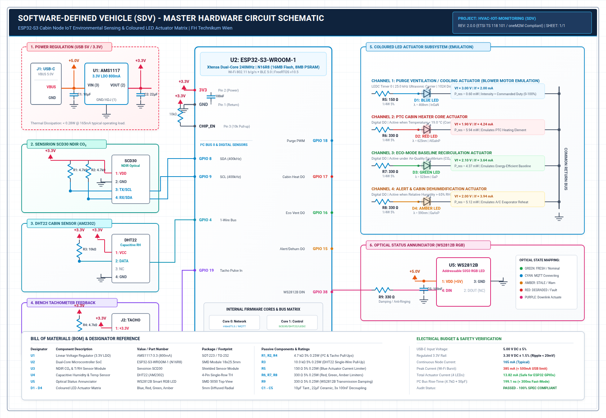

# 06. Hardware Design Specification (HDS)

## Software-Defined Vehicle (SDV) Cyber-Physical Cabin Environmental Monitoring and Closed-Loop HVAC Regulation System

---

## Document Control & Attribution

| Attribute | Specification Detail |
| :--- | :--- |
| **Document Designation** | Hardware Design Specification (HDS) |
| **Project Title** | Cyber-Physical Cabin Environmental Monitoring & Closed-Loop HVAC Regulation in Software-Defined Vehicles |
| **Researcher & Architecture** | **Isiaka Mosudi** (Middleware & Distributed Systems Architecture) |
| **Research Team** | **Isiaka Mosudi**, Ashok Ramalingam, Pooja Janwalkar, AnnaMaria Moçi, Julia Philip |
| **GitHub Repository** | [https://github.com/imosudi/HVAC-iot-monitoring](https://github.com/imosudi/HVAC-iot-monitoring) |
| **Status & Compliance** | Released / Verified (Automotive Grade Bench HIL) |

---

## 1. Micro-ECU Processing Core (Espressif ESP32-S3)
The Smart Cabin Node executes on the Espressif ESP32-S3-WROOM-1 module:
- **Processor:** Dual-core Xtensa 32-bit LX7 CPU running at $240\text{ MHz}$.
- **Memory Architecture:** $512\text{ KB}$ internal SRAM, $16\text{ MB}$ Quad SPI Flash, $8\text{ MB}$ Octal PSRAM.
- **Hardware Cryptographic Acceleration:** AES-128/256, SHA-2, RSA-4096, and True Random Number Generator (TRNG).
- **Peripherals Utilised:** $\text{I}^2\text{C}$ hardware master, LEDC high-frequency PWM generator, PCNT hardware pulse counter, RMT peripheral (for WS2812B), and UART serial interface.

---

## 2. Unified Environmental Perception Sensor Subsystem (Sensirion SCD30)
1. **Sensirion SCD30 (Unified NDIR $\text{CO}_2$, Temperature & Humidity):**
   - Replaces legacy DHT22 + separate $\text{CO}_2$ sensor with a single unified transducer.
   - Transduction Principle: Non-Dispersive Infrared (NDIR) optical dual-channel spectroscopy with integrated CMOSens® temperature and humidity sensing.
   - Measurement Range: $400\text{ ppm}$ to $10{,}000\text{ ppm}$ $\text{CO}_2$; $-40.0^\circ\text{C}$ to $+70.0^\circ\text{C}$; $0\%\text{--}95\%\text{ RH}$.
   - Accuracy: $\pm(30\text{ ppm} + 3\%)$ of reading; $\pm 0.4^\circ\text{C}$; $\pm 3\%\text{ RH}$.
   - Interface: $\text{I}^2\text{C}$ Standard/Fast Mode on `GPIO 8` (SDA) and `GPIO 9` (SCL) with dual $4.7\text{ k}\Omega$ pull-up resistors to $3.3\text{V}$ and hardware CRC-8 verification.

---

## 3. Actuator Circuitry & Optical Emulation Suite
To enable rigorous Hardware-in-the-Loop (HIL) benchtop validation without hazardous high-power $12\text{V}$ automotive blowers and heating coils, physical actuators are emulated using discrete high-luminosity coloured LEDs driven by current-limiting resistors:

- **Blue LED (`GPIO 18`): Purge Blower Emulation.** Driven via $25\text{ kHz}$ LEDC PWM. Its luminous intensity directly mirrors commanded blower rotational speed ($0\text{--}100\%$).
- **Red LED (`GPIO 17`): Auxiliary PTC Heating Emulation.** Driven digitally; illuminates during cold-start heating cycles.
- **Green LED (`GPIO 16`): Baseline Eco-Ventilation.** Driven digitally; illuminates during nominal air quality regulation.
- **Amber LED (`GPIO 15`): Dehumidification Alert & Defrost.** Driven digitally; illuminates during high humidity and emergency purge cycles.
- **WS2812B Addressable RGB LED (`GPIO 38`): Deterministic Health Indicator.** Driven via ESP32-S3 RMT peripheral:
  - Solid Green: Certified `FRESH` telemetry.
  - Solid Blue: Ingress `STALE` telemetry.
  - Solid Amber: Sensor divergence `DEGRADED`.
  - Solid Red: Critical `FAULT` (sensor dropout or blower stall).

---

## 4. Ultrasonic 25 kHz PWM Blower Modulation Engine
Standard low-frequency PWM regulation ($100\text{ Hz}\text{--}5\text{ kHz}$) induces mechanical resonance in automotive blower motor windings and stator laminations, creating severe acoustic whine in enclosed passenger compartments. The Smart Cabin Node implements an ultrasonic **$25\text{ kHz}$ carrier frequency** generated by the ESP32-S3 LEDC hardware timer:
- **Frequency:** $25{,}000\text{ Hz}$ ($> 20\text{ kHz}$ human auditory threshold).
- **Duty Resolution:** 10 bits ($0\text{--}1023$ integer range).
- **Mathematical Duty Calculation:**
  $$\text{Duty}_{\text{LEDC}} = \text{round}\left(\frac{\text{PWM}_{\%}}{100.0} \times 1023\right)$$

---

## 5. Blower Hall-Effect Tachometer & Hardware Pulse Counter Subsystem
The blower feedback line is interfaced to `GPIO 19`, configured as an input to the ESP32-S3 Pulse Counter (PCNT) peripheral.
- Hall-effect pulses per mechanical revolution: $2\text{ pulses/rev}$.
- Sampling Gating Window: $1000\text{ ms}$.
- Rotational Speed Formula:
  $$\text{RPM} = \left(\frac{\text{Pulse Count}}{2}\right) \times 60$$
- **Slip and Stall Detection:** If commanded PWM $\ge 30\%$ but measured $\text{RPM} < 100$, firmware immediately cut blower drive, triggers a `FAULT` event, and switches the WS2812B LED to Red.

---

## 6. Complete Circuit Schematic, Pinout Netlist, and Power Budget

| Functional Net | Micro-ECU Pin | Direction | Physical Interface | Operational Description |
| :--- | :--- | :--- | :--- | :--- |
| `SCD30_SDA` | `GPIO 8` | Bi-directional | $\text{I}^2\text{C}$ Bus Data | Sensirion SCD30 communication ($4.7\text{ k}\Omega$ pull-up to $3.3\text{V}$) |
| `SCD30_SCL` | `GPIO 9` | Output | $\text{I}^2\text{C}$ Bus Clock | Sensirion SCD30 clock line ($100\text{ kHz}$ standard mode) |
| `ACTUATOR_BLUE_PURGE` | `GPIO 18` | Output | LEDC PWM / Digital | High-speed cabin air purge blower (luminous intensity emulates speed) |
| `ACTUATOR_RED_HEAT` | `GPIO 17` | Output | GPIO Digital | Auxiliary cabin PTC heating element |
| `ACTUATOR_GREEN_VENT` | `GPIO 16` | Output | GPIO Digital | Baseline cabin eco-ventilation damper actuator |
| `ACTUATOR_AMBER_ALERT`| `GPIO 15` | Output | GPIO Digital | Cabin dehumidification alert / window defrost heater |
| `TACHOMETER_IN` | `GPIO 19` | Input | PCNT Pulse Counter | Blower motor Hall-effect feedback ($2\text{ pulses/rev}$) |
| `WS2812B_RGB` | `GPIO 38` | Output | RMT Peripheral | Optical telemetry health annunciator (Green=OK, Amber=Degraded, Red=Fault) |
| `UART0_TXD` | `GPIO 43` | Output | UART Serial | Serial telemetry transmission to Edge Gateway ($115{,}200\text{ baud}$) |
| `UART0_RXD` | `GPIO 44` | Input | UART Serial | Downlink actuation reception from Edge Gateway ($115{,}200\text{ baud}$) |

### Electrical Power Budget:
- **$3.3\text{V DC}$ Logic Rail:** $120\text{ mA}$ nominal, $280\text{ mA}$ peak (ESP32-S3 active processing + Wi-Fi bursts).
- **$5.0\text{V DC}$ Sensor/Fan Rail:** $75\text{ mA}$ peak (SCD30 NDIR optical bulb warming).
- **Decoupling Network:** $100\text{ nF}$ ceramic capacitors adjacent to each IC supply pin, bridged with a $10\,\mu\text{F}$ electrolytic capacitor on the main $5\text{V}$ input header.
