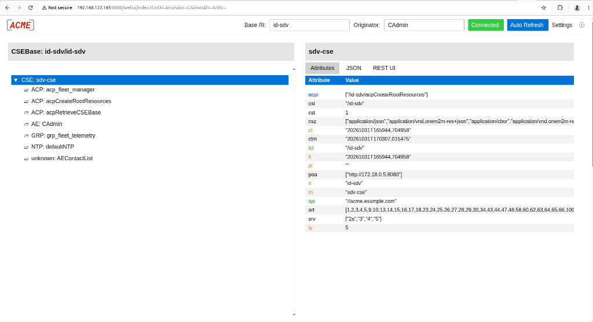
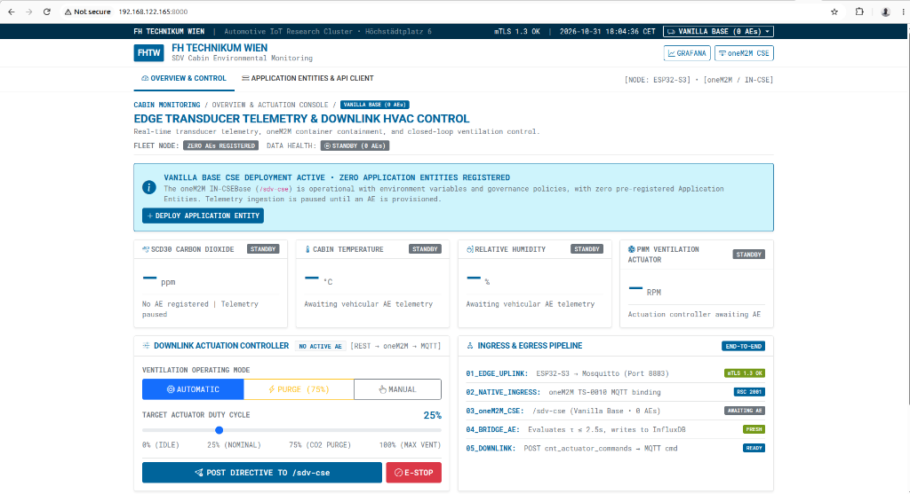

# 09. API Specification & Contract Documentation (ASCD)

## Software-Defined Vehicle (SDV) Cyber-Physical Cabin Environmental Monitoring and Closed-Loop HVAC Regulation System

---

## Document Control & Attribution

| Attribute | Specification Detail |
| :--- | :--- |
| **Document Designation** | API Specification & Contract Documentation (ASCD) |
| **Project Title** | Cyber-Physical Cabin Environmental Monitoring & Closed-Loop HVAC Regulation in Software-Defined Vehicles |
| **Researcher & Architecture** | **Isiaka Mosudi** (Middleware & Distributed Systems Architecture) |
| **Research Team** | **Isiaka Mosudi**, Ashok Ramalingam, Pooja Janwalkar, AnnaMaria Moçi, Julia Philip |
| **GitHub Repository** | [https://github.com/imosudi/HVAC-iot-monitoring](https://github.com/imosudi/HVAC-iot-monitoring) |
| **Status & Compliance** | Released / Verified (JSON Schema Draft 2020-12, oneM2M TS-0004, OpenAPI 3.0) |

---

## 1. JSON Schema Data Contracts

### 1.1 Outbound Telemetry Contract: [`docs/schemas/telemetry_schema.json`](file:///home/mosud/Documents/dev/HVAC-iot-monitoring/docs/schemas/telemetry_schema.json)
Every telemetry frame published by the Vehicular Edge Gateway strictly adheres to JSON Schema Draft 2020-12:

```json
{
  "$schema": "https://json-schema.org/draft/2020-12/schema",
  "title": "VehicularCabinTelemetryFrame",
  "type": "object",
  "properties": {
    "car_id": { "type": "string", "pattern": "^vehicle_[0-9]{2,}$" },
    "zone": { "type": "string", "enum": ["cabin_front", "cabin_rear", "cargo_trunk"], "default": "cabin_front" },
    "timestamp_unix_s": { "type": "integer", "minimum": 1700000000 },
    "scd30": {
      "type": "object",
      "properties": {
        "co2_ppm": { "type": ["number", "null"], "minimum": 0.0, "maximum": 10000.0 },
        "temperature_c": { "type": ["number", "null"], "minimum": -40.0, "maximum": 70.0 },
        "humidity_pct": { "type": ["number", "null"], "minimum": 0.0, "maximum": 100.0 }
      },
      "required": ["co2_ppm", "temperature_c", "humidity_pct"],
      "additionalProperties": false
    },
    "dht22": {
      "type": "object",
      "properties": {
        "temperature_c": { "type": ["number", "null"], "minimum": -40.0, "maximum": 80.0 },
        "humidity_pct": { "type": ["number", "null"], "minimum": 0.0, "maximum": 100.0 }
      },
      "required": ["temperature_c", "humidity_pct"],
      "additionalProperties": false
    },
    "actuator_state": {
      "type": "object",
      "properties": {
        "pwm_duty_pct": { "type": "integer", "minimum": 0, "maximum": 100 },
        "tachometer_rpm": { "type": "integer", "minimum": 0, "maximum": 6000 },
        "carrier_freq_hz": { "type": "integer", "const": 25000 }
      },
      "required": ["pwm_duty_pct", "tachometer_rpm", "carrier_freq_hz"],
      "additionalProperties": false
    }
  },
  "required": ["car_id", "zone", "timestamp_unix_s", "scd30", "dht22", "actuator_state"],
  "additionalProperties": false
}
```

### 1.2 Downlink Actuation Command Contract: [`docs/schemas/actuator_command_schema.json`](file:///home/mosud/Documents/dev/HVAC-iot-monitoring/docs/schemas/actuator_command_schema.json)
```json
{
  "$schema": "https://json-schema.org/draft/2020-12/schema",
  "title": "VehicularActuatorCommandFrame",
  "type": "object",
  "properties": {
    "target_pwm": { "type": "integer", "minimum": 0, "maximum": 100 },
    "mode": { "type": "string", "enum": ["AUTOMATIC", "MANUAL_OVERRIDE", "FAILSAFE"] },
    "timestamp_unix_s": { "type": "integer", "minimum": 1700000000 },
    "source_entity": { "type": "string" }
  },
  "required": ["target_pwm", "mode", "timestamp_unix_s"],
  "additionalProperties": false
}
```

---

## 2. MQTT Topic Taxonomy & Message Contracts
Access to the Eclipse Mosquitto MQTT broker is strictly partitioned by Topic Access Control Lists (ACLs) enforced over Mutual TLS 1.3:

| Topic Pattern | Publisher | Subscriber | Payload Schema | Security Context |
| :--- | :--- | :--- | :--- | :--- |
| `sdv/+/telemetry` | `client_edge` | `client_nodered` | `telemetry_schema.json` | mTLS 1.3 (`client_edge.crt`) |
| `sdv/+/control/cmd` | `client_nodered` | `client_actuator` | `actuator_command_schema.json`| mTLS 1.3 (`client_nodered.crt`)|
| `sdv/+/actuator/feedback` | `client_actuator` | `client_nodered` | Actuator Status JSON | mTLS 1.3 (`client_actuator.crt`)|

---

## 3. oneM2M REST CRUDN API Specification
The ACME oneM2M CSE exposes standard REST endpoints on port 8080:

```http
POST /sdv-cse/AE_CabinNode_Car01/cnt_raw_telemetry HTTP/1.1
Host: onem2m_cse:8080
X-M2M-Origin: C_CabinNode_Car01
X-M2M-RI: ri-1791639001
X-M2M-RVI: 2a
Content-Type: application/json;ty=4

{
  "m2m:cin": {
    "cnf": "application/json:0",
    "con": "{\"car_id\":\"vehicle_01\",\"timestamp_unix_s\":1791639000,\"scd30\":{\"co2_ppm\":620.5,\"temperature_c\":22.4,\"humidity_pct\":46.5},\"dht22\":{\"temperature_c\":22.6,\"humidity_pct\":47.1},\"actuator_state\":{\"pwm_duty_pct\":25,\"tachometer_rpm\":750,\"carrier_freq_hz\":25000}}"
  }
}
```

**Response:** `HTTP/201 Created` with resource identifier `<m2m:cin>`.



---

## 4. Web Management Portal REST API Contract
The custom Web Portal (`sdv_web_portal` on port 8000) exposes operational REST APIs:
- `GET /`: Management web console.
- `GET /entities`: Dynamic oneM2M Entity Explorer displaying registered vehicles.
- `GET /api/telemetry/latest`: Real-time JSON telemetry stream for cockpit gauges.
- `POST /api/actuator/dispatch`: Manual actuation override API dispatches target PWM to oneM2M middleware.
- `GET /api/onem2m/entities/<ae_rn>/tree`: Recursively queries ACME CSE to render the active oneM2M resource tree.
- `POST /api/onem2m/deploy-and-validate`: Automated one-click vehicle onboarding and container verification.
- `POST /api/onem2m/request`: Raw oneM2M primitive debugger enabling arbitrary CRUDN queries.



---

## 5. InfluxDB 2.x API & Flux Analytical Query Contracts
Historical queries execute against InfluxDB 2.7 via HTTP API (`http://influxdb:8086/api/v2/query`):
```flux
from(bucket: "cabin_telemetry")
  |> range(start: -1h)
  |> filter(fn: (r) => r._measurement == "cabin_telemetry")
  |> filter(fn: (r) => r.car_id == "vehicle_01")
  |> filter(fn: (r) => r._field == "co2_ppm" or r._field == "temp_scd30_c" or r._field == "actuator_pwm_pct")
  |> aggregateWindow(every: 10s, fn: mean, createEmpty: false)
  |> yield(name: "mean_telemetry")
```
