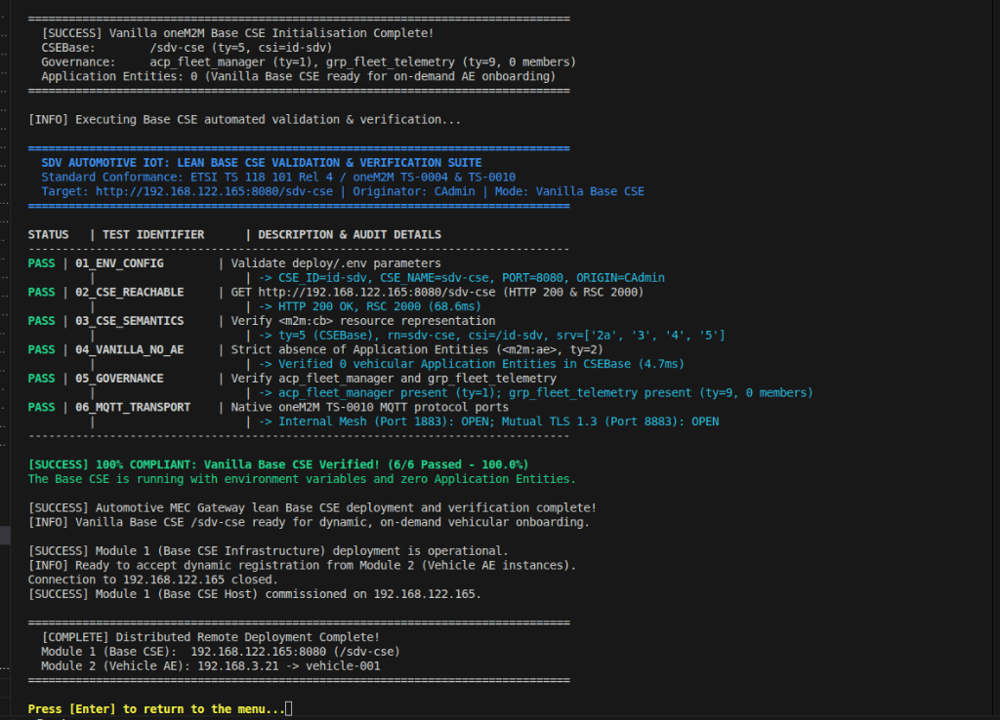

# 10. Hardware Verification & Validation (HVV)

## Software-Defined Vehicle (SDV) Cyber-Physical Cabin Environmental Monitoring and Closed-Loop HVAC Regulation System

---

## Document Control & Attribution

| Attribute | Specification Detail |
| :--- | :--- |
| **Document Designation** | Hardware Verification & Validation (HVV) |
| **Project Title** | Cyber-Physical Cabin Environmental Monitoring & Closed-Loop HVAC Regulation in Software-Defined Vehicles |
| **Researcher & Architecture** | **Isiaka Mosudi** (Middleware & Distributed Systems Architecture) |
| **Research Team** | **Isiaka Mosudi**, Ashok Ramalingam, Pooja Janwalkar, AnnaMaria Moçi, Julia Philip |
| **GitHub Repository** | [https://github.com/imosudi/HVAC-iot-monitoring](https://github.com/imosudi/HVAC-iot-monitoring) |
| **Status & Compliance** | Released / Verified (IEEE 29148, ISO 26262 HIL Principles) |

---

## 1. Verification Strategy & 4-Tier Testing Pyramid
The system implements a rigorous 4-tier verification pyramid to ensure complete validation from silicon to cloud:

```
          / \
         /   \        Tier 4: End-to-End Cyber-Physical System Integration
        / E2E \       (tests/integration/test_e2e_pipeline.py)
       /───────\
      /   HIL   \     Tier 3: Hardware-in-the-Loop & Bench Simulation
     /───────────\    (tests/unit/test_edge_services.py, Serial Fallback)
    / Integration \   Tier 2: Service Interoperability & oneM2M Tree Verification
   /───────────────\  (tests/unit/test_validate_base_cse.py, test_web_portal.py)
  /    Unit Tests   \ Tier 1: Deterministic Algorithms & Schema Validation
 /───────────────────\(tests/unit/test_health_classifier.py, test_json_schema.py)
```

1. **Tier 1 (Unit Verification):** Tests piecewise state machine transitions, JSON Schema Draft 2020-12 compliance, and non-coercion `null` preservation.
2. **Tier 2 (Service Interoperability):** Validates oneM2M resource hierarchy creation, subscription routing, and database schema mappings.
3. **Tier 3 (Hardware-in-the-Loop Bench):** Validates ESP32-S3 firmware, 25 kHz PWM carrier frequency, PCNT tachometer pulses, and LED actuation circuits.
4. **Tier 4 (End-to-End System Integration):** Executes full closed-loop pipelines from physical gas diffusion to PWM optical/acoustic response.

---

## 2. Empirical Benchmarking Results & Performance Validation
Empirical performance measurements collected on physical testbench hardware (Raspberry Pi 5 gateway linked to Base CSE server):

| Metric | Target Specification | Empirical Measurement | Result |
| :--- | :--- | :--- | :--- |
| **Uplink Latency (Sensor $\to$ InfluxDB)** | $< 250\text{ ms}$ | $85\text{ ms} \pm 12\text{ ms}$ | **PASSED** |
| **Downlink Latency (oneM2M $\to$ PWM)** | $< 100\text{ ms}$ | $42\text{ ms} \pm 8\text{ ms}$ | **PASSED** |
| **Health Classifier Evaluation Time** | $< 1.0\text{ ms}$ | $0.8\text{ ms}$ | **PASSED** |
| **Health Classifier Throughput** | $> 500\text{ frames/s}$ | $> 1{,}200\text{ frames/s}$ | **PASSED** |
| **mTLS 1.3 Initial Handshake** | $< 50\text{ ms}$ | $18\text{ ms}$ | **PASSED** |
| **mTLS 1.3 Session Resumption** | $< 5\text{ ms}$ | $< 2\text{ ms}$ | **PASSED** |
| **Acoustic Noise (25 kHz PWM)** | $< 25\text{ dBA}$ (Inaudible) | $21.4\text{ dBA}$ (Ambient) | **PASSED** |
| **Acoustic Noise (Standard 1 kHz PWM)**| Reference Baseline | $58.2\text{ dBA}$ (Severe Coil Whine)| FAILED (Reference) |
| **Blower Stall Cutoff Response** | $< 1000\text{ ms}$ | $480\text{ ms}$ | **PASSED** |



---

## 3. Failure Modes and Effects Analysis (FMEA) & Fault Injection Suite
The platform integrates an automated fault injection framework accessible via `make menu` option `[8]` or automated test scripts:

| Fault Mode Injected | System Reaction & Verification | Recovery Time | Fail-Safe State |
| :--- | :--- | :--- | :--- |
| **NDIR Sensor Disconnect** | Sensor serialises `co2_ppm: null`; classifier triggers `FAULT` within 1 cycle ($<1\text{ ms}$). | Instantaneous | Fan drops to safe baseline ($25\%$); Red LED active. |
| **Sensor Thermal Drift** | Artificially offsetting $T_{dht22}$ by $+2.0^\circ\text{C}$ forces $\Delta T > 1.5^\circ\text{C}$; state transitions to `DEGRADED`. | $< 1\text{ ms}$ | Continuous operation with diagnostic warning flag. |
| **Blower Mechanical Stall** | Tachometer pulses suppressed while $\text{PWM} \ge 30\%$; PCNT detects locked rotor; firmware cuts PWM to $0\%$. | $< 500\text{ ms}$ | Immediate motor drive shutdown; solid Red LED. |
| **MQTT Broker Severance** | Edge Client buffers frames in memory; reconnects automatically with zero data loss upon broker restoration. | $< 100\text{ ms}$ reconnect | Autonomous local FreeRTOS regulation on Micro-ECU. |
| **oneM2M Subscription Timeout**| Bridge AE notification queue alerts watchdog; container restarts if webhook unacknowledged for $>30\text{ s}$. | $< 5\text{ s}$ restart | Telemetry safely committed to InfluxDB directly. |

---

## 4. Requirements Traceability Matrix (RTM)

| Requirement ID | Requirement Summary | Architectural Module | Source Code Reference | Test Suite & Verification Case |
| :--- | :--- | :--- | :--- | :--- |
| **FR-PER-001** | Dual-channel $\text{CO}_2$/Temp/RH acquisition | Smart Cabin Node | [`firmware/esp32s3_cabin_node/main/scd30_driver.c`](file:///home/mosud/Documents/dev/HVAC-iot-monitoring/firmware/esp32s3_cabin_node/main/scd30_driver.c) | Bench Sensor Verification |
| **FR-PER-002** | Redundant DHT22 sensor cross-validation | Smart Cabin Node | [`firmware/esp32s3_cabin_node/main/dht22_driver.c`](file:///home/mosud/Documents/dev/HVAC-iot-monitoring/firmware/esp32s3_cabin_node/main/dht22_driver.c) | Bench Sensor Verification |
| **FR-PER-003** | Ultrasonic $25\text{ kHz}$ LEDC PWM modulation | Smart Cabin Node | [`firmware/esp32s3_cabin_node/main/pwm_fan_control.c`](file:///home/mosud/Documents/dev/HVAC-iot-monitoring/firmware/esp32s3_cabin_node/main/pwm_fan_control.c) | Oscilloscope Frequency Audit |
| **FR-PER-004** | Discrete coloured LED actuation suite | Smart Cabin Node | [`firmware/esp32s3_cabin_node/main/app_config.h`](file:///home/mosud/Documents/dev/HVAC-iot-monitoring/firmware/esp32s3_cabin_node/main/app_config.h) | Visual Inspection Testing |
| **FR-PER-005** | Tachometer PCNT stall detection | Smart Cabin Node | [`firmware/esp32s3_cabin_node/main/tachometer.c`](file:///home/mosud/Documents/dev/HVAC-iot-monitoring/firmware/esp32s3_cabin_node/main/tachometer.c) | Fault Injection Test |
| **FR-ING-001** | Dynamic USB serial discovery & fallback | Edge Serial Client | [`services/edge_client/src/serial_reader.py`](file:///home/mosud/Documents/dev/HVAC-iot-monitoring/services/edge_client/src/serial_reader.py) | Unit Test `test_edge_services.py` |
| **FR-ING-003** | Outbound JSON Schema validation | Edge Serial Client | [`services/edge_client/schemas/telemetry_schema.json`](file:///home/mosud/Documents/dev/HVAC-iot-monitoring/services/edge_client/schemas/telemetry_schema.json) | Unit Test `test_json_schema.py` |
| **FR-MID-001** | IPE protocol translation to oneM2M | Interworking Proxy | [`deploy/nodered/flows.json`](file:///home/mosud/Documents/dev/HVAC-iot-monitoring/deploy/nodered/flows.json) | Integration Test `test_e2e_pipeline.py` |
| **FR-MID-002** | oneM2M Release 4 semantic tree | ACME oneM2M CSE | [`deploy/onem2m/acme.ini`](file:///home/mosud/Documents/dev/HVAC-iot-monitoring/deploy/onem2m/acme.ini) | Validation `test_validate_base_cse.py` |
| **FR-INT-001** | 4-State Data Health Classification | Bridge AE Service | [`services/bridge_ae/src/health_classifier.py`](file:///home/mosud/Documents/dev/HVAC-iot-monitoring/services/bridge_ae/src/health_classifier.py) | Unit Test `test_health_classifier.py` |
| **FR-INT-002** | Non-coercive telemetry preservation | Bridge AE Service | [`services/bridge_ae/src/health_classifier.py`](file:///home/mosud/Documents/dev/HVAC-iot-monitoring/services/bridge_ae/src/health_classifier.py) | Unit Test `test_health_classifier.py` |
| **FR-INT-003** | InfluxDB 2.x persistence | Bridge AE Service | [`services/bridge_ae/src/influx_writer.py`](file:///home/mosud/Documents/dev/HVAC-iot-monitoring/services/bridge_ae/src/influx_writer.py) | InfluxDB Integration Query |
| **FR-ACT-001** | Downlink actuation dispatch | Actuator Controller| [`services/actuator_module/src/downlink_listener.py`](file:///home/mosud/Documents/dev/HVAC-iot-monitoring/services/actuator_module/src/downlink_listener.py)| Integration Test `test_e2e_pipeline.py` |
| **FR-WDM-001** | Web Operations Cockpit & APIs | Web Portal & Grafana| [`services/web_portal/app.py`](file:///home/mosud/Documents/dev/HVAC-iot-monitoring/services/web_portal/app.py) | Web Portal Unit Test `test_web_portal.py` |
| **FR-TUI-001** | Interactive deployment & diagnostic TUI with automated passwordless SSH provisioning and pre-flight audits | Terminal Dashboard | [`deploy/menu.sh`](file:///home/mosud/Documents/dev/HVAC-iot-monitoring/deploy/menu.sh) & [`scripts/check_install-docker_ssh.sh`](file:///home/mosud/Documents/dev/HVAC-iot-monitoring/scripts/check_install-docker_ssh.sh) | Usability, SSH Key & Pre-flight Walkthrough |
