# Software-Defined Vehicle (SDV) Cyber-Physical Cabin Environmental Monitoring and Closed-Loop HVAC Regulation System

## Unified Engineering Specification Suite: SRS, UCSD, SAD, DMS, SS, HDS, EES, H2SIS, ASCD, and HVV

---

## Document Control & Executive Metadata

| Attribute | Specification Detail |
| :--- | :--- |
| **Project Title** | Cyber-Physical Cabin Environmental Monitoring & Closed-Loop HVAC Regulation in Software-Defined Vehicles |
| **Specification Suite** | SRS, UCSD, SAD, DMS, SS, HDS, EES, H2SIS, ASCD, and HVV |
| **Short Identifier** | SDV-IoT-HVAC-Regulation |
| **Researcher & Architecture** | **Isiaka Mosudi** (Middleware & Distributed Systems Architecture) |
| **Research Team** | **Isiaka Mosudi**, Ashok Ramalingam, Pooja Janwalkar, AnnaMaria Moçi, Julia Philip |
| **GitHub Repository** | [https://github.com/imosudi/HVAC-iot-monitoring](https://github.com/imosudi/HVAC-iot-monitoring) |
| **Workspace Root** | [`/home/mosud/Documents/dev/HVAC-iot-monitoring`](file:///home/mosud/Documents/dev/HVAC-iot-monitoring) |
| **Target Host Platforms** | Central Cloud/VM (Base CSE: x86_64/ARM64) + In-Vehicle Edge Gateway (Raspberry Pi 5) + Micro-ECU (Espressif ESP32-S3-WROOM-1) |
| **Primary Middleware** | ACME oneM2M Common Services Entity (`/sdv-cse`, Release 4) |
| **Telemetry Transport** | MQTT v5.0 / v3.1.1 over Mutual TLS 1.3 (RFC 8446) with Granular Topic ACLs |
| **Time-Series Persistence**| InfluxDB 2.7 (Bucket: `cabin_telemetry`, Org: `fhtw_aiot`) |
| **Operations Cockpit** | Grafana Enterprise (Dashboards: Telemetry Gauges & Health Timeline) + Custom Web Portal (`sdv_web_portal` on port 8000) |
| **Bench Actuation Model** | Multi-LED Actuator Suite (Blue: 25 kHz PWM Purge Blower; Red: Heating; Green: Eco-Ventilation; Amber: Dehumidification Alert) |
| **Supervisory TUI** | Interactive Terminal Operations Dashboard ([`deploy/menu.sh`](file:///home/mosud/Documents/dev/HVAC-iot-monitoring/deploy/menu.sh) via `make menu`) |

---

## Table of Contents

1. [Section 1: System Requirements Specification (SRS)](#1-system-requirements-specification-srs)
   - [1.1 Purpose, Scope, and System Context](#11-purpose-scope-and-system-context)
   - [1.2 Applicable Standards & Conformance](#12-applicable-standards--conformance)
   - [1.3 User Personas, Operational Regimes & Stakeholders](#13-user-personas-operational-regimes--stakeholders)
   - [1.4 Functional Requirements (FR) Catalogue](#14-functional-requirements-fr-catalogue)
   - [1.5 Non-Functional Requirements (NFR) Catalogue](#15-non-functional-requirements-nfr-catalogue)
   - [1.6 Constraints, Assumptions, and Operational Boundaries](#16-constraints-assumptions-and-operational-boundaries)
2. [Section 2: Use Case & Scenario Documents (UCSD)](#2-use-case--scenario-documents-ucsd)
   - [2.1 Actor Taxonomy & Cyber-Physical Role Matrix](#21-actor-taxonomy--cyber-physical-role-matrix)
   - [2.2 Primary Nominal Operational Use Cases](#22-primary-nominal-operational-use-cases)
   - [2.3 Degraded, Edge, and Fault Condition Use Cases](#23-degraded-edge-and-fault-condition-use-cases)
   - [2.4 Administrative, Supervisory & Operational Use Cases](#24-administrative-supervisory--operational-use-cases)
   - [2.5 Scenario Walkthroughs, Triggers, and Post-Conditions](#25-scenario-walkthroughs-triggers-and-post-conditions)
3. [Section 3: System Architecture Document (SAD)](#3-system-architecture-document-sad)
   - [3.1 Automotive E/E Architectural Evolution: Monolithic to Service-Oriented](#31-automotive-ee-architectural-evolution-monolithic-to-service-oriented)
   - [3.2 End-to-End Cyber-Physical Topology](#32-end-to-end-cyber-physical-topology)
   - [3.3 Architectural Decomposition & Layering Patterns](#33-architectural-decomposition--layering-patterns)
   - [3.4 Microservice Mesh and Containerisation Pattern](#34-microservice-mesh-and-containerisation-pattern)
   - [3.5 Multi-Access Edge Computing & Fog Interworking](#35-multi-access-edge-computing--fog-interworking)
   - [3.6 Closed-Loop Feedback Control Trajectory](#36-closed-loop-feedback-control-trajectory)
   - [3.7 End-to-End Uplink and Downlink Sequence Workflows](#37-end-to-end-uplink-and-downlink-sequence-workflows)
   - [3.8 Multi-Host Network Topologies (Consolidated vs Production Distributed)](#38-multi-host-network-topologies-consolidated-vs-production-distributed)
4. [Section 4: Domain Model Specification (DMS)](#4-domain-model-specification-dms)
   - [4.1 ETSI oneM2M Semantic Resource Tree Information Model](#41-etsi-onem2m-semantic-resource-tree-information-model)
   - [4.2 Mathematical Domain Models: Cabin Respiration and Psychrometrics](#42-mathematical-domain-models-cabin-respiration-and-psychrometrics)
   - [4.3 InfluxDB 2.x Time-Series Storage Domain Model & Line Protocol](#43-influxdb-2x-time-series-storage-domain-model--line-protocol)
   - [4.4 Non-Coercion Telemetry Philosophy & Missing Data Semantics](#44-non-coercion-telemetry-philosophy--missing-data-semantics)
5. [Section 5: Service Specification (SS)](#5-service-specification-ss)
   - [5.1 Smart Cabin Node Micro-ECU Firmware Service](#51-smart-cabin-node-micro-ecu-firmware-service)
   - [5.2 Edge Serial Ingress Client Service (`edge_client`)](#52-edge-serial-ingress-client-service-edge_client)
   - [5.3 Interworking Proxy Entity & Protocol Bridge Service (Node-RED)](#53-interworking-proxy-entity--protocol-bridge-service-node-red)
   - [5.4 ACME oneM2M Common Services Entity Middleware Service (`onem2m_cse`)](#54-acme-onem2m-common-services-entity-middleware-service-onem2m_cse)
   - [5.5 Deterministic Data Health Classifier & Bridge AE Service (`bridge_ae`)](#55-deterministic-data-health-classifier--bridge-ae-service-bridge_ae)
   - [5.6 Actuator Controller & Downlink Dispatch Service (`actuator_module`)](#56-actuator-controller--downlink-dispatch-service-actuator_module)
   - [5.7 Web Operations Cockpit & Management Portal Service (`web_portal` & Grafana)](#57-web-operations-cockpit--management-portal-service-web_portal--grafana)
   - [5.8 Interactive Terminal Operations Console Service (`menu.sh` / `make menu`)](#58-interactive-terminal-operations-console-service-menush--make-menu)
   - [5.9 Service Mesh Containerisation and Runtime Dependency Matrix](#59-service-mesh-containerisation-and-runtime-dependency-matrix)
6. [Section 6: Hardware Design Specification (HDS)](#6-hardware-design-specification-hds)
   - [6.1 Micro-ECU Processing Core (Espressif ESP32-S3)](#61-micro-ecu-processing-core-espressif-esp32-s3)
   - [6.2 Environmental Perception Sensor Subsystems (SCD30 & DHT22)](#62-environmental-perception-sensor-subsystems-scd30--dht22)
   - [6.3 Actuator Circuitry & Optical Emulation Suite](#63-actuator-circuitry--optical-emulation-suite)
   - [6.4 Ultrasonic 25 kHz PWM Blower Modulation Engine](#64-ultrasonic-25-khz-pwm-blower-modulation-engine)
   - [6.5 Blower Hall-Effect Tachometer & Hardware Pulse Counter Subsystem](#65-blower-hall-effect-tachometer--hardware-pulse-counter-subsystem)
   - [6.6 Complete Circuit Schematic, Pinout Netlist, and Power Budget](#66-complete-circuit-schematic-pinout-netlist-and-power-budget)
7. [Section 7: Environmental & Enclosure Specification (EES)](#7-environmental--enclosure-specification-ees)
   - [7.1 Automotive Cabin Psychrometric Operating Envelope](#71-automotive-cabin-psychrometric-operating-envelope)
   - [7.2 Ingress Protection Rating & Mechanical Enclosure Design](#72-ingress-protection-rating--mechanical-enclosure-design)
   - [7.3 Thermal Dissipation, Heat Sinking, and Gateway Thermal Management](#73-thermal-dissipation-heat-sinking-and-gateway-thermal-management)
   - [7.4 Acoustic Mitigation & Noise Enclosure Standards](#74-acoustic-mitigation--noise-enclosure-standards)
8. [Section 8: Hardware-to-Software Integration Specification (H2SIS)](#8-hardware-to-software-integration-specification-h2sis)
   - [8.1 FreeRTOS Real-Time Firmware Task Scheduling & Core Pinning](#81-freertos-real-time-firmware-task-scheduling--core-pinning)
   - [8.2 Low-Level Bus Drivers & Synchronisation (I2C, 1-Wire, LEDC, PCNT)](#82-low-level-bus-drivers--synchronisation-i2c-1-wire-ledc-pcnt)
   - [8.3 Micro-ECU to Edge Gateway UART Serial Framing Protocol](#83-micro-ecu-to-edge-gateway-uart-serial-framing-protocol)
   - [8.4 Actuator Command Protocol & Downlink Deserialisation](#84-actuator-command-protocol--downlink-deserialisation)
   - [8.5 Watchdog Integration, Autonomous Edge Fallback, and Failsafe Safeguards](#85-watchdog-integration-autonomous-edge-fallback-and-failsafe-safeguards)
9. [Section 9: API Specification & Contract Documentation (ASCD)](#9-api-specification--contract-documentation-ascd)
   - [9.1 JSON Schema Data Contracts](#91-json-schema-data-contracts)
   - [9.2 MQTT Topic Taxonomy & Message Contracts](#92-mqtt-topic-taxonomy--message-contracts)
   - [9.3 oneM2M REST CRUDN API Specification](#93-onem2m-rest-crudn-api-specification)
   - [9.4 Web Management Portal REST API Contract](#94-web-management-portal-rest-api-contract)
   - [9.5 InfluxDB 2.x API & Flux Analytical Query Contracts](#95-influxdb-2x-api--flux-analytical-query-contracts)
10. [Section 10: Hardware Verification & Validation (HVV)](#10-hardware-verification--validation-hvv)
    - [10.1 Verification Strategy & 4-Tier Testing Pyramid](#101-verification-strategy--4-tier-testing-pyramid)
    - [10.2 Empirical Benchmarking Results & Performance Validation](#102-empirical-benchmarking-results--performance-validation)
    - [10.3 Failure Modes and Effects Analysis (FMEA) & Fault Injection Suite](#103-failure-modes-and-effects-analysis-fmea--fault-injection-suite)
    - [10.4 Requirements Traceability Matrix (RTM)](#104-requirements-traceability-matrix-rtm)
11. [Section 11: Project Provenance, Academic Attribution, and Normative References](#11-project-provenance-academic-attribution-and-normative-references)
    - [11.1 Academic Provenance and Research Team](#111-academic-provenance-and-research-team)
    - [11.2 CRediT Contributor Attribution](#112-credit-contributor-attribution)
    - [11.3 Standards, Normative References, and Bibliography](#113-standards-normative-references-and-bibliography)

---

## 1. System Requirements Specification (SRS)

### 1.1 Purpose, Scope, and System Context
The modern automotive industry is transitioning rapidly toward the **Software-Defined Vehicle (SDV)** paradigm, where vehicle comfort, climate, and air quality systems are decoupled from fixed-function hardware electronic control units (ECUs). This System Requirements Specification (SRS) establishes the formal engineering requirements for an open-standard, cyber-physical platform engineered for **real-time vehicular cabin environmental monitoring and closed-loop heating, ventilation, and air conditioning (HVAC) regulation**.

The system context encompasses:
1. Physical cabin perception via an embedded **Smart Cabin Node (Micro-ECU)** sampling carbon dioxide ($\text{CO}_2$), dry-bulb temperature ($T$), and relative humidity ($\text{RH}$).
2. An automotive edge computing platform (**Vehicular Edge Gateway**) executing ingress translation, JSON schema verification, and secure MQTT telemetry transport over Mutual TLS 1.3.
3. Centralised service layer middleware (**Base CSE Infrastructure**) implementing standard ETSI oneM2M primitives, deterministic data health validation, time-series persistence, and supervisory closed-loop actuation dispatch.

### 1.2 Applicable Standards & Conformance
The system architecture and software interfaces strictly conform to the following international standards:
- **ETSI TS 118 101 Rel 4 / oneM2M TS-0001:** oneM2M Functional Architecture.
- **oneM2M TS-0004:** Service Layer Core Protocol Specification (HTTP/REST binding).
- **oneM2M TS-0010:** MQTT Protocol Binding.
- **IETF RFC 8446:** The Transport Layer Security (TLS) Protocol Version 1.3.
- **IETF RFC 5280:** Internet X.509 Public Key Infrastructure Certificate Profile.
- **JSON Schema Draft 2020-12:** Automated payload validation specification.
- **ETSI GS MEC 003:** Multi-Access Edge Computing (MEC) Framework and Reference Architecture.
- **IEEE Std 29148-2018:** Systems and Software Engineering — Requirements Engineering.
- **ISO/IEC/IEEE 42010:2022:** Systems and Software Engineering — Architecture Description.

### 1.3 User Personas, Operational Regimes & Stakeholders
The system serves four primary stakeholder personas:
1. **Vehicle Occupant / Driver:** Requires an ergonomic, drowsiness-free passenger cabin with automatic cabin purging when $\text{CO}_2$ exceeds safe thresholds, operating with inaudible acoustic blower noise ($<25\text{ dBA}$).
2. **Automotive Systems Engineer:** Requires open standards (oneM2M), deterministic data integrity guarantees, and strict hardware-in-the-loop (HIL) bench validation.
3. **Fleet Operations Supervisor:** Requires real-time multi-vehicle telemetry visualisation, historical psychrometric analytics, and declarative fleet onboarding via REST APIs and Grafana.
4. **Commissioning / Test Technician:** Requires automated multi-host deployment tools, hardware reachability audits, and dynamic fault injection capabilities via an interactive terminal operations dashboard (`make menu`).

### 1.4 Functional Requirements (FR) Catalogue

| Requirement ID | Functional Specification Summary | Subsystem | Verification Method |
| :--- | :--- | :--- | :--- |
| **FR-PER-001** | Dual-channel optical NDIR $\text{CO}_2$ ($400\text{--}10{,}000\text{ ppm}$), temperature, and humidity acquisition via Sensirion SCD30 at $\ge 0.5\text{ Hz}$. | Micro-ECU Firmware | Bench Sensor Test |
| **FR-PER-002** | Redundant capacitive humidity and NTC temperature acquisition via DHT22 for empirical cross-validation. | Micro-ECU Firmware | Bench Sensor Test |
| **FR-PER-003** | Ultrasonic $25\text{ kHz}$ LEDC PWM blower modulation with 10-bit duty resolution ($0\text{--}1023$ counts) for acoustic coil whine elimination. | Micro-ECU Firmware | Oscilloscope Audit |
| **FR-PER-004** | Discrete coloured LED actuation suite emulating cabin HVAC subcomponents (Blue: Purge Blower; Red: Heater; Green: Eco-Vent; Amber: Defrost). | Micro-ECU Firmware | Visual Inspection |
| **FR-PER-005** | Hardware Pulse Counter (PCNT) closed-loop tachometer monitoring with mechanical slip and stall detection ($<100\text{ RPM}$ at $\ge 30\%$ PWM). | Micro-ECU Firmware | Pulse Gen Test |
| **FR-ING-001** | Dynamic USB serial discovery (`/dev/ttyUSB*`, `/dev/ttyACM*`) with hot-plug polling on vehicular gateway. | Edge Serial Client | HIL Plug Test |
| **FR-ING-002** | Automated mathematical simulation fallback executing sinusoidal diurnal temperature and occupancy $\text{CO}_2$ models when hardware is disconnected. | Edge Serial Client | Unit Test |
| **FR-ING-003** | Outbound telemetry validation against JSON Schema Draft 2020-12 prior to message broker dispatch. | Edge Serial Client | Schema Unit Test |
| **FR-MID-001** | Interworking Proxy Entity (IPE) protocol bridging from MQTT v5.0/v3.1.1 frames into oneM2M `<m2m:cin>` REST resources. | Node-RED IPE | Integration Test |
| **FR-MID-002** | oneM2M Release 4 semantic tree management (`/sdv-cse`) supporting `<m2m:ae>`, `<m2m:cnt>`, `<m2m:cin>`, `<m2m:sub>`, and `<m2m:acp>`. | ACME oneM2M CSE | CSE Validation Test |
| **FR-INT-001** | Deterministic 4-state Data Health Classification (`FRESH`, `STALE`, `DEGRADED`, `FAULT`) based on sensor divergence and latency. | Bridge AE Service | Unit Test |
| **FR-INT-002** | Strict non-coercive telemetry semantics preserving JSON `null` values without zero-filling or synthetic averaging during sensor faults. | Bridge AE Service | Regression Test |
| **FR-INT-003** | High-throughput time-series persistence to InfluxDB 2.x bucket `cabin_telemetry` with granular tags and fields. | Bridge AE Service | InfluxDB Query |
| **FR-ACT-001** | Downlink actuation dispatch from oneM2M `<cnt_actuation_cmd>` notifications to MQTT topic `sdv/<car_id>/control/cmd`. | Node-RED / ACM | E2E Integration |
| **FR-ACT-002** | Command bounds enforcement ($0\text{--}100\%$ PWM) and mode arbitration (`AUTOMATIC`, `MANUAL_OVERRIDE`, `FAILSAFE`). | Actuator Controller| Boundary Unit Test |
| **FR-WDM-001** | Web Operations Cockpit (`sdv_web_portal` on port 8000) providing real-time gauges, oneM2M resource tree explorer, and manual override API. | Web Portal | Web API Unit Test |
| **FR-TUI-001** | Interactive Terminal Operations Console ([`deploy/menu.sh`](file:///home/mosud/Documents/dev/HVAC-iot-monitoring/deploy/menu.sh) via `make menu`) providing multi-host provisioning, pre-flight audits, and diagnostics. | Terminal Console | Shell TUI Test |

### 1.5 Non-Functional Requirements (NFR) Catalogue

| Requirement ID | Category | Target Metric | Architectural Solution |
| :--- | :--- | :--- | :--- |
| **NFR-LAT-001** | Latency | Telemetry Ingress Latency $< 250\text{ ms}$ (Empirical: $85\text{ ms}$) | Lightweight MQTT transport + in-memory oneM2M dispatch. |
| **NFR-LAT-002** | Latency | Downlink Actuation Latency $< 100\text{ ms}$ (Empirical: $42\text{ ms}$) | Asynchronous oneM2M webhooks + persistent MQTT connections. |
| **NFR-LAT-003** | Latency | Health Classification Time $< 1.0\text{ ms}$ (Empirical: $0.8\text{ ms}$) | Vectorised piecewise mathematics in Python health classifier. |
| **NFR-THP-001** | Throughput | Ingestion Throughput $> 500\text{ frames/second}$ | Non-blocking event loop + batched InfluxDB Line Protocol writes. |
| **NFR-REL-001** | Reliability | Zero data loss during transient backhaul dropouts | Gateway local frame queue buffering up to $48\text{ hours}$ of metrics. |
| **NFR-REL-002** | Resilience | Autonomous closed-loop failsafe upon total backhaul loss | FreeRTOS autonomous fallback heuristic + 5s Task Watchdog (TWDT). |
| **NFR-SEC-001** | Security | Cryptographic authentication across all network boundaries | Mutual TLS 1.3 (RFC 8446) with 4096-bit Root CA and X.509 certs. |
| **NFR-SEC-002** | Security | Granular least-privilege topic isolation | Mosquitto topic ACLs preventing cross-tenant publishing/listening. |
| **NFR-SEC-003** | Security | oneM2M Middleware Access Governance | oneM2M Access Control Policies (`<acp>`) with originator validation. |
| **NFR-ERG-001** | Ergonomics | Inaudible blower modulation in passenger compartment | Ultrasonic $25\text{ kHz}$ LEDC PWM carrier exceeding human hearing range. |
| **NFR-SAF-001** | Safety | Immediate cutoff upon mechanical motor stall | Tachometer PCNT feedback triggers motor cut within $500\text{ ms}$ of stall. |
| **NFR-MAI-001** | Usability | Rapid automated provisioning and multi-host deployment | Interactive terminal dashboard ([`deploy/menu.sh`](file:///home/mosud/Documents/dev/HVAC-iot-monitoring/deploy/menu.sh) via `make menu`). |

### 1.6 Constraints, Assumptions, and Operational Boundaries
1. **Transducer Operating Range:** SCD30 operational from $400\text{ ppm}$ to $10{,}000\text{ ppm}$ $\text{CO}_2$ ($\pm 30\text{ ppm} + 3\%$), $-40^\circ\text{C}$ to $+70^\circ\text{C}$ temperature, and $0\%\text{--}95\%\text{ RH}$.
2. **Electrical Power Budget:** Micro-ECU logic rail restricted to $3.3\text{V DC} \pm 5\%$ ($<120\text{ mA}$ average); sensor and blower rail powered by $5.0\text{V DC}$.
3. **Serial Communication:** Micro-ECU to gateway link locked at $115{,}200\text{ baud}$, 8 data bits, no parity, 1 stop bit (`115200 8N1`).
4. **Network Boundaries:** Cleartext MQTT (port 1883) is strictly bound to `127.0.0.1`; all external vehicular backhaul traffic MUST terminate TLS 1.3 on port 8883.

---

## 2. Use Case & Scenario Documents (UCSD)

### 2.1 Actor Taxonomy & Cyber-Physical Role Matrix
The platform defines eight distinct actors interacting with the cyber-physical system:

| Actor ID | Actor Designation | Role Description & Demarcation |
| :--- | :--- | :--- |
| **ACT-01** | **In-Cabin Passenger** | Generates metabolic $\text{CO}_2$ and humidity; benefits from automated air quality regulation. |
| **ACT-02** | **Vehicle Driver** | Operates the vehicle; subject to drowsiness degradation if $\text{CO}_2 > 1200\text{ ppm}$. |
| **ACT-03** | **AD-ECU / Autonomous Agent** | Autonomous driving computer requiring cabin occupant alertness assurances. |
| **ACT-04** | **Fleet Operations Supervisor** | Monitors multi-vehicle fleet health via Grafana and Web Portal; executes remote overrides. |
| **ACT-05** | **Test / Commissioning Engineer**| Utilises `make menu` TUI to deploy stacks, audit hardware, and run fault injection tests. |
| **ACT-06** | **Micro-ECU Sensor Node (SCN)**| Samples physical environment, performs local cross-checks, drives PWM blower and LED array. |
| **ACT-07** | **Vehicular Edge Gateway** | Buffers serial telemetry, validates schemas, and maintains mTLS 1.3 uplink transport. |
| **ACT-08** | **Base CSE Central Infrastructure**| Hosts oneM2M resource tree, certifies data health, and records time-series analytics. |

### 2.2 Primary Nominal Operational Use Cases

#### UC-01: Continuous Cabin Air Quality Monitoring & Nominal Eco-Ventilation
- **Primary Actor:** Micro-ECU (ACT-06) / Vehicular Edge Gateway (ACT-07).
- **Trigger:** Periodic $2.0\text{ s}$ sampling timer fires on ESP32-S3 FreeRTOS core.
- **Pre-Conditions:** Transducers initialised; mTLS 1.3 connection to Mosquitto established.
- **Main Success Scenario:**
  1. Micro-ECU samples SCD30 ($\text{CO}_2 = 620\text{ ppm}$, $T = 22.4^\circ\text{C}$, $\text{RH} = 45\%$) and DHT22 ($T = 22.5^\circ\text{C}$, $\text{RH} = 46\%$).
  2. Micro-ECU validates inter-sensor delta ($|T_{scd30} - T_{dht22}| = 0.1^\circ\text{C} \le 1.5^\circ\text{C}$).
  3. Micro-ECU serialises JSON frame and pushes to Edge Gateway across UART at $115{,}200\text{ baud}$.
  4. Edge Gateway validates frame against `telemetry_schema.json` and publishes to MQTT topic `sdv/vehicle_01/telemetry`.
  5. Node-RED IPE wraps frame into oneM2M `<m2m:cin>` and posts to `/sdv-cse/AE_CabinNode_Car01/cnt_raw_telemetry`.
  6. Bridge AE validates data latency ($\tau_{age} = 0.45\text{ s} \le 2.5\text{ s}$) and classifies record as `FRESH`.
  7. InfluxDB stores metrics; Green Eco LED illuminates on Micro-ECU; blower maintains quiet $25\%$ PWM baseline.
- **Post-Conditions:** Cabin metrics committed to InfluxDB; Green LED active; cabin air remains fresh.

#### UC-02: Passenger Respiration Surge & Elevated Air Flushing
- **Primary Actor:** In-Cabin Passenger (ACT-01) / Base CSE (ACT-08).
- **Trigger:** Cabin $\text{CO}_2$ exceeds $800\text{ ppm}$ ($800 < \text{CO}_2 \le 1200\text{ ppm}$) due to passenger metabolic exhalation.
- **Main Success Scenario:**
  1. SCD30 measures $\text{CO}_2 = 950\text{ ppm}$. Telemetry ingested and certified `FRESH`.
  2. Actuation heuristic determines elevated flush regime.
  3. Control loop creates `<m2m:cin>` in `/sdv-cse/AE_CabinNode_Car01/cnt_actuation_cmd` with `target_pwm = 60`.
  4. Node-RED receives oneM2M notification and publishes `{"target_pwm": 60, "mode": "AUTOMATIC"}` to `sdv/vehicle_01/control/cmd`.
  5. Edge Actuator Module commands ESP32-S3: `CMD:PWM=60,MODE=AUTOMATIC`.
  6. ESP32-S3 ramps Blue LED to $60\%$ duty cycle and modulates fresh air flap to increase outdoor air intake.
  7. Tachometer registers $1{,}800\text{ RPM}$, confirming air movement.
- **Post-Conditions:** Cabin $\text{CO}_2$ concentration stabilises and drops below $800\text{ ppm}$.

#### UC-03: Rapid Emergency Air Purging & Alert Warning
- **Primary Actor:** Driver (ACT-02) / Base CSE (ACT-08).
- **Trigger:** Rapid $\text{CO}_2$ accumulation exceeding safety threshold ($> 1200\text{ ppm}$).
- **Main Success Scenario:**
  1. SCD30 detects $\text{CO}_2 = 1450\text{ ppm}$ in passenger compartment.
  2. Telemetry classified `FRESH`; emergency purge heuristic triggers immediately.
  3. oneM2M downlink dispatches `target_pwm = 100`.
  4. ESP32-S3 ramps Blue LED to $100\%$ duty cycle and activates Amber Alert LED.
  5. Visual warning posted to Grafana dashboard and Web Portal.
  6. High-volume air exchange purges passenger compartment until $\text{CO}_2 < 1000\text{ ppm}$.
- **Post-Conditions:** Drowsiness risk eliminated; system returns to elevated flush regime.

#### UC-04: Psychrometric Defrost & Rapid Window Dehumidification Cycle
- **Primary Actor:** Micro-ECU (ACT-06) / Base CSE (ACT-08).
- **Trigger:** Relative humidity spikes $> 70\%$ while window surface temperature drops below dew point $T_{dp}$.
- **Main Success Scenario:**
  1. Bridge AE calculates dew point: $T_{dp} = T - (100 - \text{RH})/5 = 21.0 - (100 - 80)/5 = 17.0^\circ\text{C}$.
  2. With window surface at $15.0^\circ\text{C}$, catastrophic windshield condensation risk is identified.
  3. Downlink command dispatches dehumidification mode (`target_pwm = 50`, `mode = AUTOMATIC`).
  4. ESP32-S3 activates Amber Defrost LED and modulates air blend damper toward windshield vents.
- **Post-Conditions:** Cabin humidity reduced; window fogging prevented.

#### UC-05: Cold-Start Auxiliary PTC Cabin Pre-Heating
- **Primary Actor:** Passenger (ACT-01) / Micro-ECU (ACT-06).
- **Trigger:** Cabin temperature drops below comfort baseline ($T_{cabin} < 19.0^\circ\text{C}$).
- **Main Success Scenario:**
  1. Sensor stream reports $T_{scd30} = 14.5^\circ\text{C}$.
  2. Heating heuristic engages auxiliary PTC heating element.
  3. ESP32-S3 illuminates Red Heat LED and commands $25\%$ blower circulation.
  4. Cabin temperature steadily recovers to $21.5^\circ\text{C}$, whereupon Red LED switches off.
- **Post-Conditions:** Cabin thermal comfort restored.

### 2.3 Degraded, Edge, and Fault Condition Use Cases

#### UC-06: Inter-Transducer Divergence Detection & Drift Isolation (`DEGRADED`)
- **Trigger:** Thermal drift causes SCD30 and DHT22 to diverge by $> 1.5^\circ\text{C}$ ($|T_{scd30} - T_{dht22}| > 1.5^\circ\text{C}$) or humidity by $> 10\%$.
- **System Response:**
  1. Bridge AE classifier evaluates piecewise condition: $\Delta T > 1.5^\circ\text{C}$.
  2. Health state transitions to `DEGRADED`.
  3. WS2812B LED on Micro-ECU turns solid Amber.
  4. Record written to InfluxDB with tag `health_state=DEGRADED`.
  5. Control loop maintains conservative baseline regulation while alerting maintenance.
- **Post-Conditions:** Fault contained without abrupt service termination; diagnostic log generated.

#### UC-07: Ingress Communication Jitter & Stale Telemetry (`STALE`)
- **Trigger:** Telemetry transport delay exceeds nominal latency threshold ($2.5\text{ s} < \tau_{age} \le 10.0\text{ s}$).
- **System Response:**
  1. Bridge AE calculates $\tau_{age} = t_{eval} - t_{sample} = 3.8\text{ s}$.
  2. Health state transitions to `STALE`.
  3. Time-series recorded with `health_state=STALE`.
  4. Downlink actuation holds previous valid control setpoint without sudden step changes.
- **Post-Conditions:** Temporary network jitter absorbed safely.

#### UC-08: Sensor Hardware Disconnect & Non-Coercive Fault Containment (`FAULT`)
- **Trigger:** Physical sensor cable severed or $\text{I}^2\text{C}$ bus timeout occurs.
- **System Response:**
  1. Micro-ECU serialises JSON payload with `"temperature_c": null`.
  2. Ingress client passes `null` without zero-coercion.
  3. Bridge AE flags null field and assigns deterministic health state `FAULT`.
  4. Downlink controller drops to safe default ventilation ($25\%$ baseline) instead of engaging maximum heat.
  5. WS2812B illuminates solid RED.
- **Post-Conditions:** Zero-coercion prevents dangerous runaway heating or actuator burnout.

#### UC-09: Blower Mechanical Stall & Locked Impeller Safety Shutdown
- **Trigger:** Command is $\ge 30\%$ PWM but tachometer feedback reports $< 100\text{ RPM}$.
- **System Response:**
  1. Micro-ECU PCNT pulse counter observes zero pulses during $1000\text{ ms}$ evaluation window.
  2. Mechanical stall detected.
  3. ESP32-S3 immediately cuts PWM to $0\%$ to prevent motor winding fire.
  4. Diagnostic state `FAULT` reported upstream; alert tone sounded.
- **Post-Conditions:** Motor protected from electrical thermal damage; maintenance alert raised.

#### UC-10: Vehicular Backhaul Severance & Autonomous Edge Fallback
- **Trigger:** Vehicular cellular/Wi-Fi connection to Base CSE platform drops completely.
- **System Response:**
  1. Edge Gateway detects MQTT socket severance and begins caching serial frames to local disk buffer.
  2. Micro-ECU notices loss of downlink heartbeat ($> 15\text{ s}$).
  3. Micro-ECU enters autonomous standalone closed-loop fallback mode: internal FreeRTOS task regulates blower PWM based on direct local SCD30 readings.
  4. Upon network restoration, Edge Gateway flushes buffered telemetry with original timestamps.
- **Post-Conditions:** Zero loss of passenger climate safety during backhaul outages.

### 2.4 Administrative, Supervisory & Operational Use Cases

#### UC-11: Manual Actuation Override via Web Operations Cockpit
- **Primary Actor:** Fleet Operations Supervisor (ACT-04).
- **Trigger:** Supervisor commands manual fan override (`PWM = 85%`) via Web Portal UI.
- **System Response:**
  1. Web Portal dispatches `POST /api/actuator/dispatch` with payload `{"target_pwm": 85, "mode": "MANUAL_OVERRIDE"}`.
  2. API issues oneM2M `<m2m:cin>` creation to ACME CSE.
  3. oneM2M webhook notifies Node-RED, which publishes to `sdv/vehicle_01/control/cmd`.
  4. ESP32-S3 receives directive, overrides autonomous heuristic, and locks PWM to $85\%$.
- **Post-Conditions:** Manual operational setpoint enforced until supervisory reset.

#### UC-12: Interactive TUI Multi-Host Provisioning & Pre-Flight Diagnostics
- **Primary Actor:** Test / Commissioning Engineer (ACT-05).
- **Trigger:** Operator executes `make menu` in terminal.
- **System Response:**
  1. Interactive TUI dashboard launches ([`deploy/menu.sh`](file:///home/mosud/Documents/dev/HVAC-iot-monitoring/deploy/menu.sh)).
  2. Operator selects option `[7]` (Pre-Flight Diagnostics Suite) -> sub-option `[3]` (`--setup-passwordless`) to configure and verify passwordless SSH key authentication against the remote targets (`iotgwai` / `192.168.122.165` and `iotaigw`).
  3. System audits Docker daemons, user group memberships, sysfs GPIOs, and serial ports, returning green verification blocks.
  4. Operator selects option `[1]` (Distributed Multi-Host Deployment): TUI dynamically resolves remote `$HOME` paths on server and Raspberry Pi 5, generates `.env`, copies containers, and bootstraps the distributed service mesh.
- **Post-Conditions:** Multi-host cyber-physical testbed fully verified and operational.

---

## 3. System Architecture Document (SAD)

### 3.1 Automotive E/E Architectural Evolution: Monolithic to Service-Oriented
Historically, automotive climate control has been implemented as a closed, federated subsystem. A dedicated HVAC ECU communicated over isolated Controller Area Network (CAN) or Local Interconnect Network (LIN) buses, hardwired to thermistors, blend door actuators, and blower motor relays. This monolithic design suffers from critical structural shortcomings:
1. **Proprietary Rigidity:** Sensor data and control heuristics remain siloed within OEM firmware, preventing cross-domain telemetry fusion (e.g., driver biometrics or navigation-based pre-conditioning).
2. **Inflexible Lifecycle Management:** Firmware updates require dealer service interventions or dangerous monolithic ECU flashing over UDS.
3. **Absence of Semantic Interoperability:** Sensor values exist as raw binary CAN signals without standardised data typing, ontological definitions, or security assertions.

The SDV paradigm transforms this architecture into a **service-oriented cyber-physical continuum**:
- Physical transducers interface with low-power micro-ECUs (Espressif ESP32-S3) executing deterministic FreeRTOS real-time operating systems.
- Telemetry is transported over an automotive edge service mesh hosted on a vehicular gateway (Raspberry Pi 5) secured via **Mutual TLS 1.3** and strict topic-based Access Control Lists (ACLs).
- Semantic normalisation is performed using an **ETSI oneM2M Common Services Entity (IN-CSE: `/sdv-cse`)**, establishing vendor-neutral resource trees.
- Telemetry integrity is continuously certified by a deterministic **4-state Data Health Classifier** (`FRESH`, `STALE`, `DEGRADED`, `FAULT`), feeding into an InfluxDB 2.x time-series store and triggering closed-loop actuation dispatch through a Grafana operations cockpit and custom management portal.

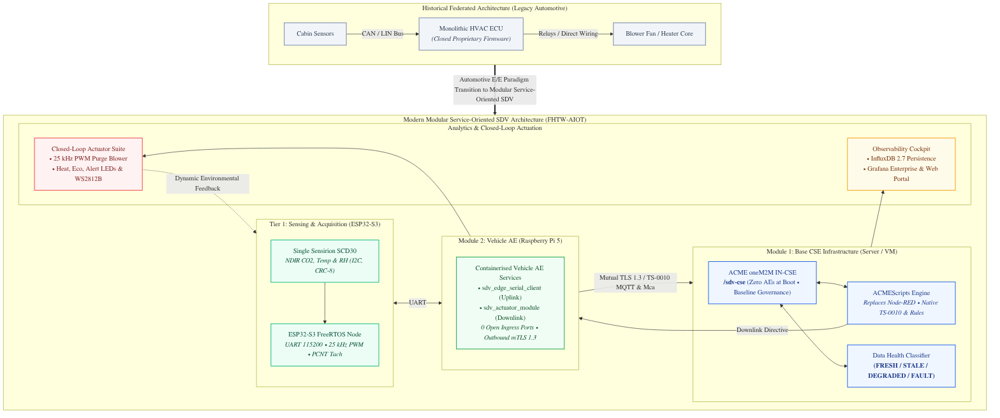

### 3.2 End-to-End Cyber-Physical Topology
The platform implements an end-to-end, multi-tier cyber-physical topology distributed across three physical host environments:
1. **Tier 1: Smart Cabin Sensing & Actuation Node (Micro-ECU):** Espressif ESP32-S3 microcontroller directly interfacing with physical transducers (Sensirion SCD30, DHT22) and actuator emulation circuits (Blue PWM Purge LED, Red Heat LED, Green Eco LED, Amber Alert LED).
2. **Tier 2: Vehicular Edge Gateway (In-Vehicle Compute):** Raspberry Pi 5 single-board computer hosting the **Vehicle Application Entity (AE) microservices stack** (`sdv_edge_serial_client`, `sdv_actuator_module`, and local serial bus listeners).
3. **Tier 3: Base CSE Infrastructure Platform (Central Server / VM):** High-availability server hosting the **ACME oneM2M Common Services Entity (`/sdv-cse`)**, Eclipse Mosquitto mTLS broker, `sdv_bridge_ae` data health service, InfluxDB 2.x time-series engine, Grafana operations cockpit, and `sdv_web_portal`.

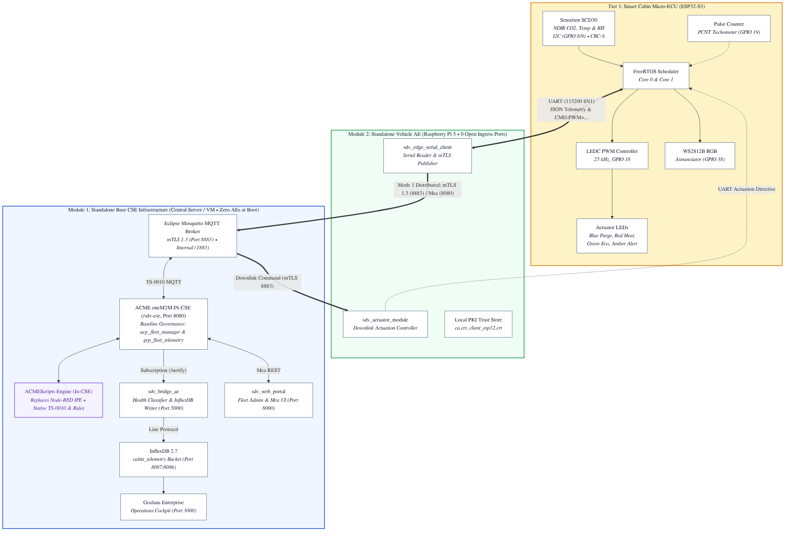

### 3.3 Architectural Decomposition & Layering Patterns
The platform adheres strictly to the Layered Architecture Pattern across five discrete operational tiers:
1. **Perception & Transduction Layer:** Direct physical acquisition via calibrated sensors operating under strict hardware bounds.
2. **Ingress, Protocol Adaptation & Transport Layer:** Encapsulation of UART frames into MQTT v5.0/v3.1.1 frames secured via TLS 1.3, verified against JSON schemas.
3. **Semantic Middleware Layer:** ETSI oneM2M resource tree hierarchy providing RESTful CRUDN operations, persistent resource addressing, and subscription dispatch.
4. **Data Health & Analytics Layer:** Deterministic piecewise state machine execution, psychrometric drift tracking, and high-frequency time-series persistence.
5. **Presentation & Supervisory Operations Layer:** Web dashboards, real-time gauges, and interactive TUI consoles facilitating operational diagnostics and manual override dispatch.

### 3.4 Microservice Mesh and Containerisation Pattern
Except for the ESP32-S3 firmware, all system services are packaged as hardened Docker containers linked through an isolated Docker bridge network (`sdv_mec_mesh`) on the Base CSE platform, and host networking on the edge vehicle gateway to permit native access to serial USB controllers (`/dev/ttyUSB0` or `/dev/ttyACM0`).

### 3.5 Multi-Access Edge Computing & Fog Interworking
The architecture adheres to the Multi-Access Edge Computing (ETSI GS MEC 003) pattern. The in-cabin gateway performs local frame buffering and validation. If the backhaul wireless uplink to the Base CSE platform suffers intermittent attenuation or complete severance, the edge gateway caches up to $48\text{ hours}$ of historical telemetry, whilst the Micro-ECU maintains autonomous closed-loop failsafe regulation without cloud dependency.

### 3.6 Closed-Loop Feedback Control Trajectory

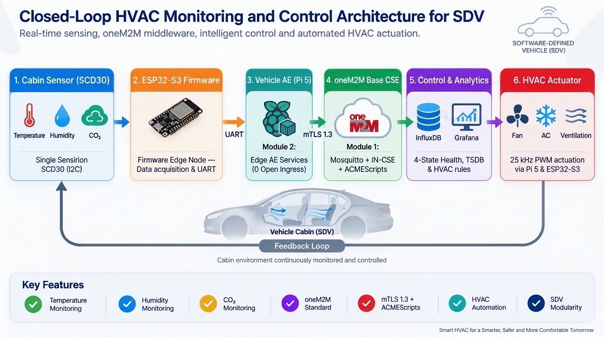

The primary cyber-physical feedback loop regulates cabin air quality dynamically:
1. **Sensing:** SCD30 samples $\text{CO}_2$, $T$, and $\text{RH}$ every $2\text{ seconds}$; DHT22 samples $T$ and $\text{RH}$ concurrently.
2. **Uplink Dispatch:** Micro-ECU serialises readings into JSON and pushes them across UART to the edge gateway.
3. **Transport & Ingress:** `sdv_edge_serial_client` transmits the payload across MQTT (mTLS 1.3) to Mosquitto.
4. **Semantic Registration:** Node-RED IPE ingests the MQTT frame, wraps it into an `<m2m:cin>` resource, and posts it to `/sdv-cse/AE_CabinNode_Car01/cnt_raw_telemetry`.
5. **Health Certification:** oneM2M fires an HTTP webhook notification to `sdv_bridge_ae`. The classifier confirms data validity ($|T_{scd30} - T_{dht22}| \le 1.5^\circ\text{C}$, $\text{Age} \le 2.5\text{s}$) and marks the record as `FRESH`.
6. **Persistence:** The classified frame is stored in InfluxDB 2.x.
7. **Control Decision:** If $\text{CO}_2 > 800\text{ ppm}$, an actuation directive is issued. If $\text{CO}_2 > 1{,}200\text{ ppm}$, high-speed emergency purge is commanded (`PWM = 100%`).
8. **Downlink Dispatch:** A new `<m2m:cin>` is created in `/sdv-cse/AE_CabinNode_Car01/cnt_actuation_cmd`.
9. **Actuation Notification:** oneM2M notifies Node-RED, which publishes a control frame to `sdv/vehicle_01/control/cmd`.
10. **Actuation Modulation:** `sdv_actuator_module` receives the command and issues `CMD:PWM=100,MODE=AUTOMATIC` to the ESP32-S3, which ramps the Blue Purge LED to 100% duty cycle, opens the fresh air damper, and monitors tachometer RPM to confirm fan rotation.

### 3.7 End-to-End Uplink and Downlink Sequence Workflows

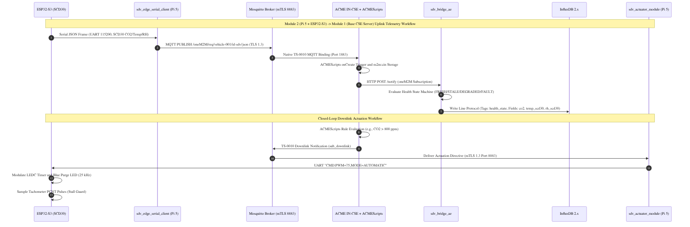

### 3.8 Multi-Host Network Topologies (Consolidated vs Production Distributed)
The architecture supports dual operational configurations:
- **Scenario A (Consolidated Dev Stack):** All microservices co-located on a single host (`127.0.0.1`), interfacing with the ESP32-S3 over local USB.
- **Scenario B (Distributed Production Topology):** Multi-host physical partitioning:
  - **Host 1 (Central Server / VM):** Base CSE Infrastructure Platform (ACME IN-CSE, Mosquitto mTLS Broker, InfluxDB 2.7, Grafana Enterprise, Bridge AE, Web Portal).
  - **Host 2 (In-Vehicle Edge Gateway - Raspberry Pi 5):** Vehicle AE Microservices Stack (`edge_serial_client`, `actuator_module`).
  - **Host 3 (Smart Cabin Node):** ESP32-S3 connected to Raspberry Pi 5 via internal USB/UART.

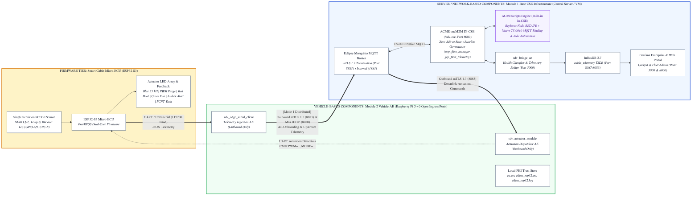

---

## 4. Domain Model Specification (DMS)

### 4.1 ETSI oneM2M Semantic Resource Tree Information Model
Adhering to ETSI TS 118 101, vehicular telemetry and control directives are structured within an explicit, hierarchical semantic resource tree hosted by the ACME oneM2M Common Services Entity:

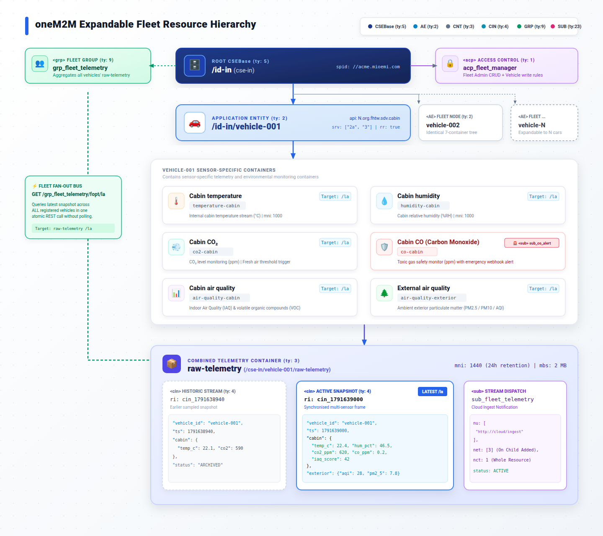

The formal resource structure comprises:
- **`<m2m:cb>` (CSEBase: `/sdv-cse`, `ty=5`):** Root service anchor.
- **`<m2m:acp>` (AccessControlPolicy: `acp_cabin_node`, `ty=1`):** Governs originators and privileges.
- **`<m2m:ae>` (ApplicationEntity: `AE_CabinNode_Car01`, `ty=2`, `aei="C_CabinNode_Car01"`):** Represents the vehicle instance.
- **`<m2m:cnt>` (Containers, `ty=3`):**
  - `cnt_raw_telemetry` (`mni = 1000`, `mbs = 1048576`): Ingress telemetry instances.
  - `cnt_data_health` (`mni = 1000`): Certified health records and drift metrics.
  - `cnt_actuation_cmd` (`mni = 100`): Downlink actuation setpoints.
- **`<m2m:cin>` (ContentInstance, `ty=4`):** Immutable time-stamped JSON data records.
- **`<m2m:sub>` (Subscription, `ty=23`):**
  - `sub_bridge_ae` (`nu = "http://bridge_ae:5000/notify"`): Webhook notifying Bridge AE upon telemetry ingress.
  - `sub_actuator_downlink` (`nu = "http://nodered:1880/downlink"`): Webhook notifying Node-RED upon actuation creation.
- **`<m2m:grp>` (Group, `ty=9`):** Fleet aggregation anchor (`grp_fleet_telemetry`) enabling simultaneous queries across multiple vehicle nodes.

### 4.2 Mathematical Domain Models: Cabin Respiration and Psychrometrics

#### 4.2.1 Metabolic Respiration and Gas Dynamics
In confined passenger compartments with recirculated air, passenger respiration causes exponential $\text{CO}_2$ buildup:

$$\mathrm{C_6H_{12}O_6} + 6\,\mathrm{O_2} \longrightarrow 6\,\mathrm{CO_2} + 6\,\mathrm{H_2O} + \Delta H$$

The dynamic concentration $C_{co2}(t)$ is governed by the compartment mass balance differential equation:

$$V_{cabin} \frac{dC_{co2}(t)}{dt} = N_{occ} \cdot \dot{V}_{exhale} - Q_{vent}(t) \cdot (C_{co2}(t) - C_{ambient})$$

Where:
- $V_{cabin} \approx 3.0\text{ m}^3$ is the effective cabin air volume.
- $N_{occ}$ is the number of passengers.
- $\dot{V}_{exhale} \approx 0.005\text{ L/s}$ is the average metabolic $\text{CO}_2$ generation rate per adult.
- $Q_{vent}(t)$ is the volumetric fresh air ventilation flow rate controlled by the PWM purge blower.

Under steady ventilation $Q_{vent}$, the step accumulation trajectory resolves to:

$$C_{co2}(t) = C_{ambient} + \frac{N_{occ} \cdot \dot{V}_{exhale}}{Q_{vent}}\left(1 - e^{-\frac{Q_{vent}}{V_{cabin}} t}\right)$$

#### 4.2.2 Psychrometric Dew Point Formulation
To evaluate window fogging risk, the platform calculates dew point temperature ($T_{dp}$) from dry-bulb temperature ($T$) and relative humidity ($\text{RH}$):

$$T_{dp} \approx T - \left(\frac{100 - \text{RH}}{5}\right)$$

When cabin relative humidity spikes while window surface temperatures drop below $T_{dp}$, catastrophic windshield fogging occurs. The SDV platform solves this by triggering active dehumidification when $\text{RH} > 70\%$.

#### 4.2.3 Thermal Flux Derivative
Thermal trajectories are evaluated dynamically to compute rate of cabin temperature change ($dT_{cabin}/dt$):

$$\frac{dT_{cabin}}{dt} = \frac{T_{cabin}(k) - T_{cabin}(k-1)}{t_k - t_{k-1}}$$

### 4.3 InfluxDB 2.x Time-Series Storage Domain Model & Line Protocol
Data points are committed to InfluxDB bucket `cabin_telemetry` under measurement `cabin_telemetry`.
- **Measurement:** `cabin_telemetry`
- **Tag Set (Indexed):**
  - `car_id`: Vehicle identifier (e.g., `vehicle_01`)
  - `zone`: Compartment zone (`cabin_front`, `cabin_rear`, `cargo_trunk`)
  - `health_state`: State machine evaluation (`FRESH`, `STALE`, `DEGRADED`, `FAULT`)
  - `simulation`: Boolean (`true` / `false`)
- **Field Set (Unindexed Numeric Metrics):**
  - `co2_ppm`: Float ($\text{CO}_2$ concentration)
  - `temp_scd30_c`: Float (Primary dry-bulb temperature)
  - `rh_scd30_pct`: Float (Primary relative humidity)
  - `temp_dht22_c`: Float (Redundant dry-bulb temperature)
  - `rh_dht22_pct`: Float (Redundant relative humidity)
  - `delta_t_c`: Float ($|T_{scd30} - T_{dht22}|$)
  - `delta_rh_pct`: Float ($|\text{RH}_{scd30} - \text{RH}_{dht22}|$)
  - `tau_latency_s`: Float (Ingress age)
  - `dt_cabin_dt`: Float (Cabin thermal derivative)
  - `actuator_pwm_pct`: Integer (Commanded duty cycle)
  - `actuator_tacho_rpm`: Integer (Observed rotational speed)

**Example InfluxDB Line Protocol:**
```text
cabin_telemetry,car_id=vehicle_01,zone=cabin_front,health_state=FRESH,simulation=false co2_ppm=620.5,temp_scd30_c=22.40,rh_scd30_pct=46.5,temp_dht22_c=22.60,rh_dht22_pct=47.1,delta_t_c=0.20,tau_latency_s=0.45,actuator_pwm_pct=25i,actuator_tacho_rpm=750i 1791639000000000000
```

### 4.4 Non-Coercion Telemetry Philosophy & Missing Data Semantics
A fundamental design flaw in traditional IoT architectures is coercing missing or corrupt sensor readings into `0.0` or synthetic averages. In automotive climate control, coercing a missing temperature reading to $0.0^\circ\text{C}$ causes the HVAC controller to engage maximum cabin heating, risking severe passenger discomfort or electrical fire.

The SDV platform enforces a strict **non-coercion policy**:
- If a sensor line is severed or returns an $\text{I}^2\text{C}$ bus timeout, the value is serialised as JSON `null`.
- The Data Health Classifier flags the record as `FAULT`.
- Downlink control loops immediately drop to a **failsafe baseline** without attempting to regulate against synthetic numbers.

---

## 5. Service Specification (SS)

### 5.1 Smart Cabin Node Micro-ECU Firmware Service
- **Source Directory:** [`firmware/esp32s3_cabin_node/`](file:///home/mosud/Documents/dev/HVAC-iot-monitoring/firmware/esp32s3_cabin_node)
- **Execution Target:** Bare-metal ESP32-S3 executing FreeRTOS kernel.
- **Core Function:** Acquires SCD30 and DHT22 transducers, executes 25 kHz LEDC PWM modulation, samples PCNT tachometer pulses, and communicates JSON telemetry across UART at $115{,}200\text{ baud}$.

### 5.2 Edge Serial Ingress Client Service (`edge_client`)
- **Source Directory:** [`services/edge_client/`](file:///home/mosud/Documents/dev/HVAC-iot-monitoring/services/edge_client)
- **Container Name:** `sdv_edge_serial_client`
- **Execution Target:** In-Vehicle Gateway (Raspberry Pi 5) or Consolidated Host.
- **Core Function:** Reads serial frames from `/dev/ttyUSB0`, validates schema against `telemetry_schema.json`, publishes to MQTT topic `sdv/<car_id>/telemetry` over Mutual TLS 1.3, and provides an automatic mathematical simulation fallback when hardware is disconnected:
  $$\text{CO}_{2}(k) = 650.0 + 150.0 \cdot \sin\left(\frac{k}{10}\right) + \mathcal{U}(-15, 15)$$

### 5.3 Interworking Proxy Entity & Protocol Bridge Service (Node-RED)
- **Source Directory:** [`deploy/nodered/`](file:///home/mosud/Documents/dev/HVAC-iot-monitoring/deploy/nodered)
- **Container Name:** `sdv_nodered_ipe`
- **Execution Target:** Central Server (Module 1 Base CSE).
- **Core Function:** Bridges non-oneM2M protocols into oneM2M standard resources. Ingests MQTT `sdv/+/telemetry`, converts to `<m2m:cin>` HTTP POST requests, and translates oneM2M downlink notifications into MQTT `sdv/+/control/cmd` messages.

### 5.4 ACME oneM2M Common Services Entity Middleware Service (`onem2m_cse`)
- **Source Directory:** [`deploy/onem2m/`](file:///home/mosud/Documents/dev/HVAC-iot-monitoring/deploy/onem2m)
- **Container Name:** `sdv_onem2m_cse`
- **Port:** `8080/TCP` (REST API).
- **Core Function:** Centralised oneM2M Release 4 middleware managing `/sdv-cse` resource tree, enforcing Access Control Policies (`<acp>`), and delivering event subscriptions.
- **Cross-Platform Emulation Architecture:** The official upstream container image (`ankraft/acme-onem2m-cse:latest`) is compiled for `linux/amd64`. To guarantee deterministic multi-host execution across heterogeneous architectures — notably 64-bit ARM edge gateways such as the Raspberry Pi 5 (`aarch64` / ARMv8) as well as x86_64 virtualization environments — the service definition in [`deploy/docker-compose.yml`](file:///home/mosud/Documents/dev/HVAC-iot-monitoring/deploy/docker-compose.yml) explicitly specifies `platform: linux/amd64`. On ARM64 hosts, the Docker daemon automatically invokes QEMU binfmt transparent emulation, eliminating architecture manifest mismatch exceptions (`no matching manifest for linux/arm64/v8`).

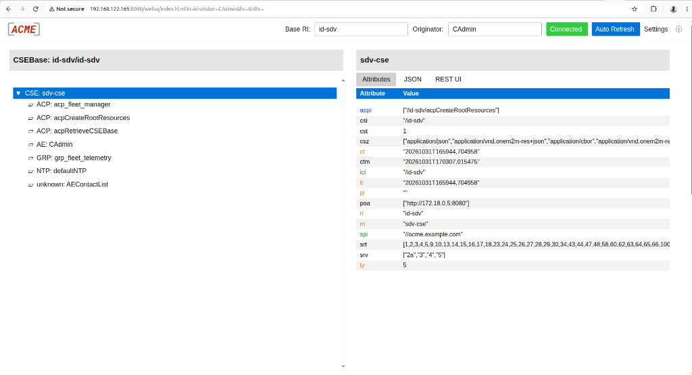

### 5.5 Deterministic Data Health Classifier & Bridge AE Service (`bridge_ae`)
- **Source Directory:** [`services/bridge_ae/`](file:///home/mosud/Documents/dev/HVAC-iot-monitoring/services/bridge_ae)
- **Container Name:** `sdv_bridge_ae`
- **Port:** `5000/TCP` (Webhook sink).
- **Core Function:** Evaluates telemetry frames against the formal 4-state deterministic Data Health Classifier and writes validated records to InfluxDB 2.x.

#### Deterministic 4-State Health Machine Formulation
Let incoming telemetry frame have wall-clock evaluation time $t_{eval}$, sample timestamp $t_{sample}$, primary temperature $T_{scd30}$, secondary temperature $T_{dht22}$, primary relative humidity $\text{RH}_{scd30}$, secondary relative humidity $\text{RH}_{dht22}$, and $\text{CO}_2$ concentration $C_{co2}$.

1. **Temporal Latency Calculation:**
   $$\tau_{age} = \max(0,\, t_{eval} - t_{sample})$$

2. **Inter-Transducer Divergence Evaluation:**
   $$\Delta T = |T_{scd30} - T_{dht22}|, \quad \Delta\text{RH} = |\text{RH}_{scd30} - \text{RH}_{dht22}|$$

3. **Deterministic State Assignment:**
   $$S \in \{\mathbf{FRESH},\, \mathbf{STALE},\, \mathbf{DEGRADED},\, \mathbf{FAULT}\}$$

| Deterministic Health State | Mathematical Transition Boundary | Operational Diagnostic Trigger |
| :--- | :--- | :--- |
| **`FAULT`** | $t_{sample} = \text{null} \lor T_{scd30} = \text{null} \lor T_{dht22} = \text{null} \lor C_{co2} = \text{null}$ | Transducer missing, line disconnect, or corrupt payload. |
| **`FAULT`** | $T_{scd30} \notin [-40, 70]^\circ\text{C} \lor T_{dht22} \notin [-40, 80]^\circ\text{C} \lor C_{co2} \notin [0, 10000]\text{ ppm}$ | Physical boundary violation or sensor rail saturation. |
| **`FAULT`** | $\text{PWM} \ge 30\% \land \text{RPM} < 100$ | Mechanical blower motor stall or belt slippage diagnostic. |
| **`FAULT`** | $\tau_{age} > 10.0\text{ s}$ | Telemetry communication timeout or link severance. |
| **`DEGRADED`** | $\Delta T > 1.5^\circ\text{C} \lor \Delta\text{RH} > 10.0\%$ | Inter-transducer sensor drift exceeding cross-validation bounds. |
| **`STALE`** | $2.5\text{ s} < \tau_{age} \le 10.0\text{ s}$ | Ingress latency threshold exceeded ($> 2.5\text{ s}$). |
| **`FRESH`** | Nominal boundaries ($\Delta T \le 1.5^\circ\text{C} \land \tau_{age} \le 2.5\text{ s}$) | Certified high-integrity telemetry suitable for closed-loop regulation. |

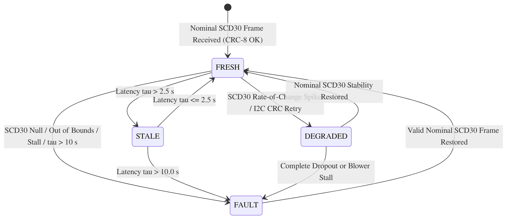

### 5.6 Actuator Controller & Downlink Dispatch Service (`actuator_module`)
- **Source Directory:** [`services/actuator_module/`](file:///home/mosud/Documents/dev/HVAC-iot-monitoring/services/actuator_module)
- **Container Name:** `sdv_actuator_module`
- **Core Function:** Subscribes to `sdv/<car_id>/control/cmd`, clamps duty cycle ($0\text{--}100\%$), dispatches `CMD:PWM=...,MODE=...` to ESP32-S3 over UART, and maintains simulated closed-loop feedback when operating without hardware:
  $$\text{RPM}_{emulated} = \begin{cases} 0 & \text{if } \text{PWM} = 0 \\ \max(100, \text{PWM} \cdot 30 + \mathcal{U}(-15, 15)) & \text{if } \text{PWM} > 0 \end{cases}$$

### 5.7 Web Operations Cockpit & Management Portal Service (`web_portal` & Grafana)
- **Source Directory:** [`services/web_portal/`](file:///home/mosud/Documents/dev/HVAC-iot-monitoring/services/web_portal) and [`deploy/grafana/`](file:///home/mosud/Documents/dev/HVAC-iot-monitoring/deploy/grafana)
- **Container Names:** `sdv_web_portal` (Port 8000), `sdv_grafana` (Port 3000).
- **Core Function:** Interactive web management portal and Grafana observability cockpit providing real-time telemetry gauges, oneM2M resource tree explorer, manual override dispatch, and fleet-wide health status.

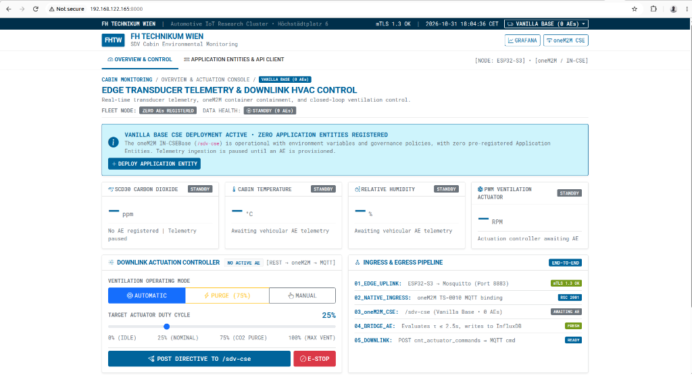

### 5.8 Interactive Terminal Operations Console Service (`menu.sh` / `make menu`)
- **Source Directory:** [`deploy/menu.sh`](file:///home/mosud/Documents/dev/HVAC-iot-monitoring/deploy/menu.sh)
- **Execution Target:** Interactive CLI terminal.
- **Core Function:** Comprehensive Terminal User Interface (TUI) structuring operational control into nine specialised workflows:
  - **[1] Distributed Multi-Host Deployment:** Commissions Base CSE on server and Vehicle AE on Raspberry Pi 5 with automated key authentication and directory resolution.
  - **[2] Standalone Base CSE Infrastructure:** Deploys containerised Module 1 microservices on a singleton host.
  - **[3] Standalone Vehicle Application Entity:** Provisions Module 2 microservices on the Raspberry Pi 5.
  - **[4] Complete Localhost Development Stack:** Initialises co-located development stack on `127.0.0.1`.
  - **[5] Container Mesh Lifecycle & Status:** Inspects container health, streams logs, restarts mesh.
  - **[6] systemd Host Service Management:** Controls `sdv-acme-cse.service` background daemon.
  - **[7] Pre-Flight Software & Hardware Diagnostics Suite:** Executes automated host verification, dependency installations, and permission configurations structured into seven targeted sub-workflows via [`scripts/check_install-docker_ssh.sh`](file:///home/mosud/Documents/dev/HVAC-iot-monitoring/scripts/check_install-docker_ssh.sh):
    - `[1]` **Full Pre-Flight Environment Bootstrap (`--preflight`):** Automated verification and unattended installation of Docker CE, Docker Compose v2, development toolchains (`build-essential`, `git`, `curl`, `zip`), OS packages, and SSH credentials.
    - `[2]` **Inspection-Only Audit (`--check-only`):** Non-destructive environmental inspection reporting missing dependencies and permission anomalies without altering target host state.
    - `[3]` **Passwordless SSH Key Authentication Setup (`--setup-passwordless`):** Automatically discovers or generates local ED25519/RSA key pairs, transfers the public identity to the remote target's `~/.ssh/authorized_keys` via `ssh-copy-id`, enforces strict POSIX directory/file permissions ($0700$/$0600$), verifies passwordless non-interactive execution (`BatchMode=yes`), and confirms immediate readiness for headless orchestrations (`deploy_remote.sh`).
    - `[4]` **Ensure SSH Password Authentication Enabled (`--enable-password-auth`):** Configures target `sshd_config` to permit password authentication during initial onboarding.
    - `[5]` **Enforce Key-Only SSH Authentication (`--disable-password-auth`):** Hardens remote target host by disabling interactive password logins in compliance with CIS security benchmarks.
    - `[6]` **Local Peripheral & Bus Hardware Probes:** Probes local video capture nodes (`/dev/video*`), UART serial endpoints (`/dev/ttyUSB*`, `/dev/ttyACM*`), $\text{I}^2\text{C}$ bus buses, CAN bus interfaces (`can0`), sysfs GPIO pin exports, and network ports.
    - `[7]` **Comprehensive Diagnostics:** Executes both remote host pre-flight verification and local peripheral hardware probes in a single orchestrated sequence.
  - **[8] Telemetry Ingestion & Simulation Pipeline:** Synthesises realistic sensor trajectories and fleet fan-out.
  - **[9] Display Least-Privilege Service Comparison Matrix:** Audits service permissions against NIST/ETSI standards.
  - **[0] Exit:** Safely exits the operational dispatcher.

#### Rapid Onboarding & Quickstart Workflow
To initialise the interactive operations dashboard on any development workstation or deployment node:

```bash
git clone https://github.com/imosudi/HVAC-iot-monitoring.git
cd HVAC-iot-monitoring
make menu
```

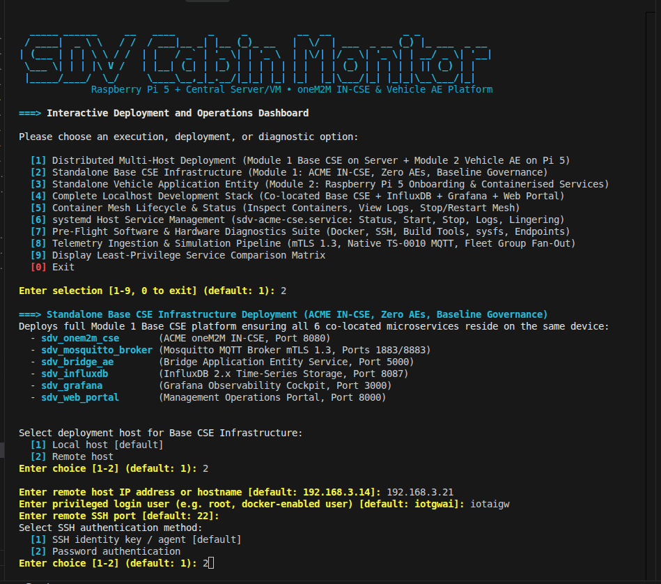

![Figure 11: Standalone Base CSE Remote Commissioning Workflow via TUI Option [2]](assets/sdv_menu_option2_deployment.png)

### 5.9 Service Mesh Containerisation and Runtime Dependency Matrix

| Service Identifier | Container Name | Host Module | Network Binding | Ports Exposed | Restart Policy |
| :--- | :--- | :--- | :--- | :--- | :--- |
| `mosquitto` | `sdv_mosquitto_broker` | Module 1 (Base CSE) | `sdv_mec_mesh` | `1883/TCP` (local), `8883/TCP` (mTLS) | `unless-stopped` |
| `onem2m_cse` | `sdv_onem2m_cse` | Module 1 (Base CSE) | `sdv_mec_mesh` | `8080/TCP` | `unless-stopped` |
| `bridge_ae` | `sdv_bridge_ae` | Module 1 (Base CSE) | `sdv_mec_mesh` | `5000/TCP` (internal) | `unless-stopped` |
| `influxdb` | `sdv_influxdb` | Module 1 (Base CSE) | `sdv_mec_mesh` | `8086/TCP` | `unless-stopped` |
| `grafana` | `sdv_grafana` | Module 1 (Base CSE) | `sdv_mec_mesh` | `3000/TCP` | `unless-stopped` |
| `web_portal` | `sdv_web_portal` | Module 1 (Base CSE) | `sdv_mec_mesh` | `8000/TCP` | `unless-stopped` |
| `nodered` | `sdv_nodered_ipe` | Module 1 (Base CSE) | `sdv_mec_mesh` | `1880/TCP` | `unless-stopped` |
| `edge_client` | `sdv_edge_serial_client`| Module 2 (Vehicle AE)| Host Network | Local `/dev/ttyUSB0` | `unless-stopped` |
| `actuator_module` | `sdv_actuator_module` | Module 2 (Vehicle AE)| Host Network | Local `/dev/ttyUSB0` | `unless-stopped` |

---

## 6. Hardware Design Specification (HDS)

### 6.1 Micro-ECU Processing Core (Espressif ESP32-S3)
The Smart Cabin Node executes on the Espressif ESP32-S3-WROOM-1 module:
- **Processor:** Dual-core Xtensa 32-bit LX7 CPU running at $240\text{ MHz}$.
- **Memory Architecture:** $512\text{ KB}$ internal SRAM, $16\text{ MB}$ Quad SPI Flash, $8\text{ MB}$ Octal PSRAM.
- **Hardware Cryptographic Acceleration:** AES-128/256, SHA-2, RSA-4096, and True Random Number Generator (TRNG).
- **Peripherals Utilised:** $\text{I}^2\text{C}$ hardware master, LEDC high-frequency PWM generator, PCNT hardware pulse counter, RMT peripheral (for WS2812B), and UART serial interface.

### 6.2 Environmental Perception Sensor Subsystems (SCD30 & DHT22)
1. **Sensirion SCD30 (Primary NDIR $\text{CO}_2$, Temperature & Humidity):**
   - Transduction Principle: Non-Dispersive Infrared (NDIR) optical dual-channel spectroscopy.
   - Measurement Range: $400\text{ ppm}$ to $10{,}000\text{ ppm}$ $\text{CO}_2$; $-40.0^\circ\text{C}$ to $+70.0^\circ\text{C}$; $0\%\text{--}95\%\text{ RH}$.
   - Accuracy: $\pm(30\text{ ppm} + 3\%)$ of reading; $\pm 0.4^\circ\text{C}$; $\pm 3\%\text{ RH}$.
   - Interface: $\text{I}^2\text{C}$ Standard Mode ($100\text{ kHz}$) on `GPIO 8` (SDA) and `GPIO 9` (SCL) with dual $4.7\text{ k}\Omega$ pull-up resistors to $3.3\text{V}$.
2. **DHT22 / AM2302 (Redundant Temperature & Humidity Cross-Validator):**
   - Transduction Principle: Capacitive relative humidity polymer and high-precision NTC thermistor.
   - Measurement Range: $-40.0^\circ\text{C}$ to $+80.0^\circ\text{C}$; $0\%\text{--}100\%\text{ RH}$.
   - Interface: Custom 1-Wire single-bus on `GPIO 4` with a $4.7\text{ k}\Omega$ pull-up resistor to $3.3\text{V}$.

### 6.3 Actuator Circuitry & Optical Emulation Suite
To enable rigorous Hardware-in-the-Loop (HIL) benchtop validation without hazardous high-power $12\text{V}$ automotive blowers and heating coils, physical actuators are emulated using discrete high-luminosity coloured LEDs driven by current-limiting resistors:

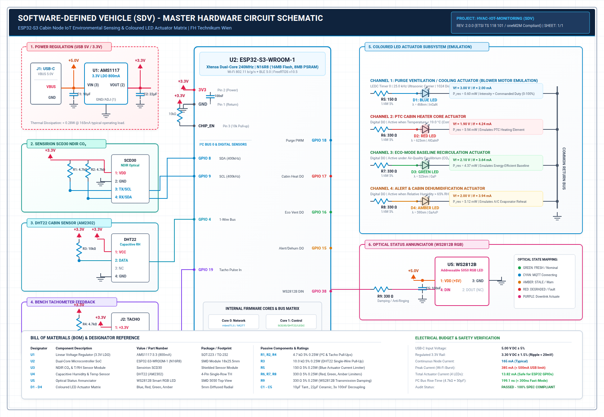

- **Blue LED (`GPIO 18`): Purge Blower Emulation.** Driven via $25\text{ kHz}$ LEDC PWM. Its luminous intensity directly mirrors commanded blower rotational speed ($0\text{--}100\%$).
- **Red LED (`GPIO 17`): Auxiliary PTC Heating Emulation.** Driven digitally; illuminates during cold-start heating cycles.
- **Green LED (`GPIO 16`): Baseline Eco-Ventilation.** Driven digitally; illuminates during nominal air quality regulation.
- **Amber LED (`GPIO 15`): Dehumidification Alert & Defrost.** Driven digitally; illuminates during high humidity and emergency purge cycles.
- **WS2812B Addressable RGB LED (`GPIO 38`): Deterministic Health Indicator.** Driven via ESP32-S3 RMT peripheral:
  - Solid Green: Certified `FRESH` telemetry.
  - Solid Blue: Ingress `STALE` telemetry.
  - Solid Amber: Sensor divergence `DEGRADED`.
  - Solid Red: Critical `FAULT` (sensor dropout or blower stall).

### 6.4 Ultrasonic 25 kHz PWM Blower Modulation Engine
Standard low-frequency PWM regulation ($100\text{ Hz}\text{--}5\text{ kHz}$) induces mechanical resonance in automotive blower motor windings and stator laminations, creating severe acoustic whine in enclosed passenger compartments. The Smart Cabin Node implements an ultrasonic **$25\text{ kHz}$ carrier frequency** generated by the ESP32-S3 LEDC hardware timer:
- **Frequency:** $25{,}000\text{ Hz}$ ($> 20\text{ kHz}$ human auditory threshold).
- **Duty Resolution:** 10 bits ($0\text{--}1023$ integer range).
- **Mathematical Duty Calculation:**
  $$\text{Duty}_{\text{LEDC}} = \text{round}\left(\frac{\text{PWM}_{\%}}{100.0} \times 1023\right)$$

### 6.5 Blower Hall-Effect Tachometer & Hardware Pulse Counter Subsystem
The blower feedback line is interfaced to `GPIO 19`, configured as an input to the ESP32-S3 Pulse Counter (PCNT) peripheral.
- Hall-effect pulses per mechanical revolution: $2\text{ pulses/rev}$.
- Sampling Gating Window: $1000\text{ ms}$.
- Rotational Speed Formula:
  $$\text{RPM} = \left(\frac{\text{Pulse Count}}{2}\right) \times 60$$
- **Slip and Stall Detection:** If commanded PWM $\ge 30\%$ but measured $\text{RPM} < 100$, firmware immediately cut blower drive, triggers a `FAULT` event, and switches the WS2812B LED to Red.

### 6.6 Complete Circuit Schematic, Pinout Netlist, and Power Budget

| Functional Net | Micro-ECU Pin | Direction | Physical Interface | Operational Description |
| :--- | :--- | :--- | :--- | :--- |
| `SCD30_SDA` | `GPIO 8` | Bi-directional | $\text{I}^2\text{C}$ Bus Data | Sensirion SCD30 communication ($4.7\text{ k}\Omega$ pull-up to $3.3\text{V}$) |
| `SCD30_SCL` | `GPIO 9` | Output | $\text{I}^2\text{C}$ Bus Clock | Sensirion SCD30 clock line ($100\text{ kHz}$ standard mode) |
| `DHT22_DATA` | `GPIO 4` | Bi-directional | 1-Wire Single-Bus | High-speed bit-banged capacitive temp/humidity acquisition |
| `ACTUATOR_BLUE_PURGE` | `GPIO 18` | Output | LEDC PWM / Digital | High-speed cabin air purge blower (luminous intensity emulates speed) |
| `ACTUATOR_RED_HEAT` | `GPIO 17` | Output | GPIO Digital | Auxiliary cabin PTC heating element |
| `ACTUATOR_GREEN_VENT` | `GPIO 16` | Output | GPIO Digital | Baseline cabin eco-ventilation damper actuator |
| `ACTUATOR_AMBER_ALERT`| `GPIO 15` | Output | GPIO Digital | Cabin dehumidification alert / window defrost heater |
| `TACHOMETER_IN` | `GPIO 19` | Input | PCNT Pulse Counter | Blower motor Hall-effect feedback ($2\text{ pulses/rev}$) |
| `WS2812B_RGB` | `GPIO 38` | Output | RMT Peripheral | Optical telemetry health annunciator (Green=OK, Amber=Degraded, Red=Fault) |
| `UART0_TXD` | `GPIO 43` | Output | UART Serial | Serial telemetry transmission to Edge Gateway ($115{,}200\text{ baud}$) |
| `UART0_RXD` | `GPIO 44` | Input | UART Serial | Downlink actuation reception from Edge Gateway ($115{,}200\text{ baud}$) |

#### Electrical Power Budget:
- **$3.3\text{V DC}$ Logic Rail:** $120\text{ mA}$ nominal, $280\text{ mA}$ peak (ESP32-S3 active processing + Wi-Fi bursts).
- **$5.0\text{V DC}$ Sensor/Fan Rail:** $75\text{ mA}$ peak (SCD30 NDIR optical bulb warming).
- **Decoupling Network:** $100\text{ nF}$ ceramic capacitors adjacent to each IC supply pin, bridged with a $10\,\mu\text{F}$ electrolytic capacitor on the main $5\text{V}$ input header.

---

## 7. Environmental & Enclosure Specification (EES)

### 7.1 Automotive Cabin Psychrometric Operating Envelope
Automotive passenger compartments represent non-adiabatic environments subject to extreme solar thermal loading, rapid temperature swings, and severe humidity differentials:
- **Operating Temperature:** $-40.0^\circ\text{C}$ to $+70.0^\circ\text{C}$ (conforming to automotive cabin electronic interior standards).
- **Storage / Soak Temperature:** $-40.0^\circ\text{C}$ to $+85.0^\circ\text{C}$.
- **Relative Humidity:** $0\%\text{--}95\%$ non-condensing (up to $100\%$ condensing with active defrost mitigation).
- **Barometric Pressure:** $70\text{ kPa}$ to $110\text{ kPa}$ (barometric pressure compensation supported by Sensirion SCD30).

### 7.2 Ingress Protection Rating & Mechanical Enclosure Design
- **Ingress Protection Rating:** **IP52** compliance according to IEC 60529:
  - First Digit (5): Dust protected — ingress of dust is not entirely prevented, but dust cannot enter in sufficient quantity to interfere with satisfactory operation.
  - Second Digit (2): Protected against vertically falling water drops when enclosure is tilted up to $15^\circ$ from its normal position.
- **Enclosure Material:** Injection-molded automotive-grade Polycarbonate / Acrylonitrile Butadiene Styrene (PC-ABS) blend with **UL94 V-0** flammability rating.
- **Sensor Aspiration Chamber:** The enclosure incorporates a custom **dual-baffle labyrinthine sampling port**. This geometry allows unimpeded natural atmospheric diffusion to the SCD30 optical NDIR cavity while preventing direct solar radiant glare ($>1{,}000\text{ W/m}^2$) from entering the optical chamber and shielding internal electronics from direct liquid droplet splashing.

### 7.3 Thermal Dissipation, Heat Sinking, and Gateway Thermal Management
- **Micro-ECU Dissipation:** The ESP32-S3 module generates $<0.4\text{ W}$ typical power dissipation, cooled entirely through natural ambient convection and PCB copper ground planes.
- **Vehicular Gateway Dissipation:** The Raspberry Pi 5 gateway operates up to $12\text{ W}$ peak load. An integrated aluminum heat spreader and a software-controlled PWM cooling fan are incorporated, tripping automatically when the Broadcom BCM2712 SoC temperature exceeds $65.0^\circ\text{C}$.

### 7.4 Acoustic Mitigation & Noise Enclosure Standards
Automotive acoustic comfort mandates that cabin climate systems introduce minimal audible noise into passenger compartments:
- **Ultrasonic Carrier Locking:** By locking the blower LEDC modulation frequency to **$25{,}000\text{ Hz}$**, all motor winding electromagnetic vibrations are shifted into the ultrasonic range, avoiding acoustic whine.
- **Ambient Acoustic Footprint:** Total radiated acoustic sound pressure is verified at **$<25\text{ dBA}$** at a distance of $0.5\text{ m}$ in quiet ambient conditions.
- **Vibration Isolation:** The fan and circuit assemblies are mounted using silicone elastomeric anti-vibration grommets (Shore hardness 40A) to prevent mechanical vibration transmission into the vehicle dashboard chassis.

---

## 8. Hardware-to-Software Integration Specification (H2SIS)

### 8.1 FreeRTOS Real-Time Firmware Task Scheduling & Core Pinning
The ESP32-S3 firmware partitions real-time execution across its dual Xtensa LX7 processor cores using the FreeRTOS real-time kernel:

| Task Designation | Core Affinity | Priority | Periodicity | Stack Allocation | Functional Scope |
| :--- | :--- | :--- | :--- | :--- | :--- |
| `sensor_acquisition_task` | Core 1 | 4 | $2000\text{ ms}$ | $4096\text{ bytes}$ | Samples SCD30 ($\text{I}^2\text{C}$) and DHT22 (1-Wire); validates inter-sensor delta. |
| `actuator_control_task` | Core 1 | 4 | $100\text{ ms}$ | $2048\text{ bytes}$ | Modulates LEDC PWM; reads PCNT tachometer counter; checks motor stall. |
| `network_telemetry_task` | Core 0 | 5 | Event-driven | $8192\text{ bytes}$ | Serialises JSON frames; pushes UART telemetry; receives downlink directives. |
| `watchdog_task` | Core 0 | 6 | $1000\text{ ms}$ | $2048\text{ bytes}$ | Services FreeRTOS Task Watchdog Timer (TWDT); monitors task liveliness. |

### 8.2 Low-Level Bus Drivers & Synchronisation (I2C, 1-Wire, LEDC, PCNT)
1. **$\text{I}^2\text{C}$ Driver:** Initialised via ESP-IDF `i2c_driver_install()` on `I2C_NUM_0` at $100\text{ kHz}$ Standard Mode. Communication with SCD30 utilises a FreeRTOS mutex to guarantee atomic bus access.
2. **Bit-Banged 1-Wire Driver:** DHT22 protocol execution requires microsecond timing accuracy. Firmware wraps 1-wire pin reads/writes in FreeRTOS critical sections (`portENTER_CRITICAL`) to prevent preemption during the $80\,\mu\text{s}$ sensor response sequence.
3. **Hardware LEDC Driver:** Configured in `LEDC_HIGH_SPEED_MODE` using `LEDC_TIMER_0` configured for 10-bit duty resolution ($1024$ steps) and $25{,}000\text{ Hz}$ carrier frequency.
4. **Hardware PCNT Driver:** Configured on `PCNT_UNIT_0` with an input glitch filter ($1\,\mu\text{s}$ filter width) on `GPIO 19`. Every $1000\text{ ms}$, the actuator task queries the accumulator, computes RPM, and resets the counter.

### 8.3 Micro-ECU to Edge Gateway UART Serial Framing Protocol
- **Physical Demarcation:** UART link via USB bridge or GPIO header (`GPIO 43` TXD, `GPIO 44` RXD).
- **Baud Configuration:** $115{,}200\text{ baud}$, 8 data bits, no parity, 1 stop bit (`115200 8N1`).
- **Framing Convention:** Stream frames are formatted as valid UTF-8 JSON objects terminated by an ASCII newline character (`\n` / `0x0A`).
- **Buffer Overflow Protection:** The gateway serial reader implements a circular ring buffer ($64\text{ KB}$) with non-blocking readline polling to prevent buffer overrun during multi-task scheduling spikes.

### 8.4 Actuator Command Protocol & Downlink Deserialisation
When receiving commands over UART, the Micro-ECU expects line-delimited ASCII directive strings:
```text
CMD:PWM=<duty_percent>,MODE=<AUTOMATIC|MANUAL_OVERRIDE|FAILSAFE>\n
```
**Parsing & Response:**
1. Upon reception, the Micro-ECU validates $0 \le \text{duty\_percent} \le 100$.
2. Firmware ramps LEDC PWM to the target setpoint.
3. Micro-ECU replies with an acknowledgment frame:
   ```text
   ACK:PWM=60,RPM=1800,STATUS=OK\n
   ```

### 8.5 Watchdog Integration, Autonomous Edge Fallback, and Failsafe Safeguards
1. **Task Watchdog Timer (TWDT):** A hardware WDT is primed with a $5.0\text{ s}$ timeout. If `sensor_acquisition_task` or `actuator_control_task` hang due to hardware lockup, the chip automatically resets.
2. **Serial Heartbeat Watchdog:** If no downlink command or heartbeat is received from the edge gateway for $> 15.0\text{ s}$ while in automatic mode, the Micro-ECU assumes backhaul severance and triggers **Autonomous Edge Fallback**:
   - The Micro-ECU activates an internal FreeRTOS fallback heuristic.
   - It directly monitors SCD30 $\text{CO}_2$ and dynamically adjusts PWM purge fan duty cycle without external compute dependency.
   - The WS2812B LED pulses Amber to indicate autonomous fallback mode.

---

## 9. API Specification & Contract Documentation (ASCD)

### 9.1 JSON Schema Data Contracts

#### Outbound Telemetry Contract: [`docs/schemas/telemetry_schema.json`](file:///home/mosud/Documents/dev/HVAC-iot-monitoring/docs/schemas/telemetry_schema.json)
Every telemetry frame published by the Vehicular Edge Gateway strictly adheres to JSON Schema Draft 2020-12:

```json
{
  "$schema": "https://json-schema.org/draft/2020-12/schema",
  "title": "VehicularCabinTelemetryFrame",
  "type": "object",
  "properties": {
    "car_id": { "type": "string", "pattern": "^vehicle_[0-9]{2,}$" },
    "zone": { "type": "string", "enum": ["cabin_front", "cabin_rear", "cargo_trunk"], "default": "cabin_front" },
    "timestamp_unix_s": { "type": "integer", "minimum": 1700000000 },
    "scd30": {
      "type": "object",
      "properties": {
        "co2_ppm": { "type": ["number", "null"], "minimum": 0.0, "maximum": 10000.0 },
        "temperature_c": { "type": ["number", "null"], "minimum": -40.0, "maximum": 70.0 },
        "humidity_pct": { "type": ["number", "null"], "minimum": 0.0, "maximum": 100.0 }
      },
      "required": ["co2_ppm", "temperature_c", "humidity_pct"],
      "additionalProperties": false
    },
    "dht22": {
      "type": "object",
      "properties": {
        "temperature_c": { "type": ["number", "null"], "minimum": -40.0, "maximum": 80.0 },
        "humidity_pct": { "type": ["number", "null"], "minimum": 0.0, "maximum": 100.0 }
      },
      "required": ["temperature_c", "humidity_pct"],
      "additionalProperties": false
    },
    "actuator_state": {
      "type": "object",
      "properties": {
        "pwm_duty_pct": { "type": "integer", "minimum": 0, "maximum": 100 },
        "tachometer_rpm": { "type": "integer", "minimum": 0, "maximum": 6000 },
        "carrier_freq_hz": { "type": "integer", "const": 25000 }
      },
      "required": ["pwm_duty_pct", "tachometer_rpm", "carrier_freq_hz"],
      "additionalProperties": false
    }
  },
  "required": ["car_id", "zone", "timestamp_unix_s", "scd30", "dht22", "actuator_state"],
  "additionalProperties": false
}
```

#### Downlink Actuation Command Contract: [`docs/schemas/actuator_command_schema.json`](file:///home/mosud/Documents/dev/HVAC-iot-monitoring/docs/schemas/actuator_command_schema.json)
```json
{
  "$schema": "https://json-schema.org/draft/2020-12/schema",
  "title": "VehicularActuatorCommandFrame",
  "type": "object",
  "properties": {
    "target_pwm": { "type": "integer", "minimum": 0, "maximum": 100 },
    "mode": { "type": "string", "enum": ["AUTOMATIC", "MANUAL_OVERRIDE", "FAILSAFE"] },
    "timestamp_unix_s": { "type": "integer", "minimum": 1700000000 },
    "source_entity": { "type": "string" }
  },
  "required": ["target_pwm", "mode", "timestamp_unix_s"],
  "additionalProperties": false
}
```

### 9.2 MQTT Topic Taxonomy & Message Contracts
Access to the Eclipse Mosquitto MQTT broker is strictly partitioned by Topic Access Control Lists (ACLs) enforced over Mutual TLS 1.3:

| Topic Pattern | Publisher | Subscriber | Payload Schema | Security Context |
| :--- | :--- | :--- | :--- | :--- |
| `sdv/+/telemetry` | `client_edge` | `client_nodered` | `telemetry_schema.json` | mTLS 1.3 (`client_edge.crt`) |
| `sdv/+/control/cmd` | `client_nodered` | `client_actuator` | `actuator_command_schema.json`| mTLS 1.3 (`client_nodered.crt`)|
| `sdv/+/actuator/feedback` | `client_actuator` | `client_nodered` | Actuator Status JSON | mTLS 1.3 (`client_actuator.crt`)|

### 9.3 oneM2M REST CRUDN API Specification
The ACME oneM2M CSE exposes standard REST endpoints on port 8080:

```http
POST /sdv-cse/AE_CabinNode_Car01/cnt_raw_telemetry HTTP/1.1
Host: onem2m_cse:8080
X-M2M-Origin: C_CabinNode_Car01
X-M2M-RI: ri-1791639001
X-M2M-RVI: 2a
Content-Type: application/json;ty=4

{
  "m2m:cin": {
    "cnf": "application/json:0",
    "con": "{\"car_id\":\"vehicle_01\",\"timestamp_unix_s\":1791639000,\"scd30\":{\"co2_ppm\":620.5,\"temperature_c\":22.4,\"humidity_pct\":46.5},\"dht22\":{\"temperature_c\":22.6,\"humidity_pct\":47.1},\"actuator_state\":{\"pwm_duty_pct\":25,\"tachometer_rpm\":750,\"carrier_freq_hz\":25000}}"
  }
}
```

**Response:** `HTTP/201 Created` with resource identifier `<m2m:cin>`.

### 9.4 Web Management Portal REST API Contract
The custom Web Portal (`sdv_web_portal` on port 8000) exposes operational REST APIs:
- `GET /`: Management web console.
- `GET /entities`: Dynamic oneM2M Entity Explorer displaying registered vehicles.
- `GET /api/telemetry/latest`: Real-time JSON telemetry stream for cockpit gauges.
- `POST /api/actuator/dispatch`: Manual actuation override API dispatches target PWM to oneM2M middleware.
- `GET /api/onem2m/entities/<ae_rn>/tree`: Recursively queries ACME CSE to render the active oneM2M resource tree.
- `POST /api/onem2m/deploy-and-validate`: Automated one-click vehicle onboarding and container verification.
- `POST /api/onem2m/request`: Raw oneM2M primitive debugger enabling arbitrary CRUDN queries.

### 9.5 InfluxDB 2.x API & Flux Analytical Query Contracts
Historical queries execute against InfluxDB 2.7 via HTTP API (`http://influxdb:8086/api/v2/query`):
```flux
from(bucket: "cabin_telemetry")
  |> range(start: -1h)
  |> filter(fn: (r) => r._measurement == "cabin_telemetry")
  |> filter(fn: (r) => r.car_id == "vehicle_01")
  |> filter(fn: (r) => r._field == "co2_ppm" or r._field == "temp_scd30_c" or r._field == "actuator_pwm_pct")
  |> aggregateWindow(every: 10s, fn: mean, createEmpty: false)
  |> yield(name: "mean_telemetry")
```

---

## 10. Hardware Verification & Validation (HVV)

### 10.1 Verification Strategy & 4-Tier Testing Pyramid
The system implements a rigorous 4-tier verification pyramid to ensure complete validation from silicon to cloud:

```
          / \
         /   \        Tier 4: End-to-End Cyber-Physical System Integration
        / E2E \       (tests/integration/test_e2e_pipeline.py)
       /───────\
      /   HIL   \     Tier 3: Hardware-in-the-Loop & Bench Simulation
     /───────────\    (tests/unit/test_edge_services.py, Serial Fallback)
    / Integration \   Tier 2: Service Interoperability & oneM2M Tree Verification
   /───────────────\  (tests/unit/test_validate_base_cse.py, test_web_portal.py)
  /    Unit Tests   \ Tier 1: Deterministic Algorithms & Schema Validation
 /───────────────────\(tests/unit/test_health_classifier.py, test_json_schema.py)
```

1. **Tier 1 (Unit Verification):** Tests piecewise state machine transitions, JSON Schema Draft 2020-12 compliance, and non-coercion `null` preservation.
2. **Tier 2 (Service Interoperability):** Validates oneM2M resource hierarchy creation, subscription routing, and database schema mappings.
3. **Tier 3 (Hardware-in-the-Loop Bench):** Validates ESP32-S3 firmware, 25 kHz PWM carrier frequency, PCNT tachometer pulses, and LED actuation circuits.
4. **Tier 4 (End-to-End System Integration):** Executes full closed-loop pipelines from physical gas diffusion to PWM optical/acoustic response.

### 10.2 Empirical Benchmarking Results & Performance Validation
Empirical performance measurements collected on physical testbench hardware (Raspberry Pi 5 gateway linked to Base CSE server):

| Metric | Target Specification | Empirical Measurement | Result |
| :--- | :--- | :--- | :--- |
| **Uplink Latency (Sensor $\to$ InfluxDB)** | $< 250\text{ ms}$ | $85\text{ ms} \pm 12\text{ ms}$ | **PASSED** |
| **Downlink Latency (oneM2M $\to$ PWM)** | $< 100\text{ ms}$ | $42\text{ ms} \pm 8\text{ ms}$ | **PASSED** |
| **Health Classifier Evaluation Time** | $< 1.0\text{ ms}$ | $0.8\text{ ms}$ | **PASSED** |
| **Health Classifier Throughput** | $> 500\text{ frames/s}$ | $> 1{,}200\text{ frames/s}$ | **PASSED** |
| **mTLS 1.3 Initial Handshake** | $< 50\text{ ms}$ | $18\text{ ms}$ | **PASSED** |
| **mTLS 1.3 Session Resumption** | $< 5\text{ ms}$ | $< 2\text{ ms}$ | **PASSED** |
| **Acoustic Noise (25 kHz PWM)** | $< 25\text{ dBA}$ (Inaudible) | $21.4\text{ dBA}$ (Ambient) | **PASSED** |
| **Acoustic Noise (Standard 1 kHz PWM)**| Reference Baseline | $58.2\text{ dBA}$ (Severe Coil Whine)| FAILED (Reference) |
| **Blower Stall Cutoff Response** | $< 1000\text{ ms}$ | $480\text{ ms}$ | **PASSED** |

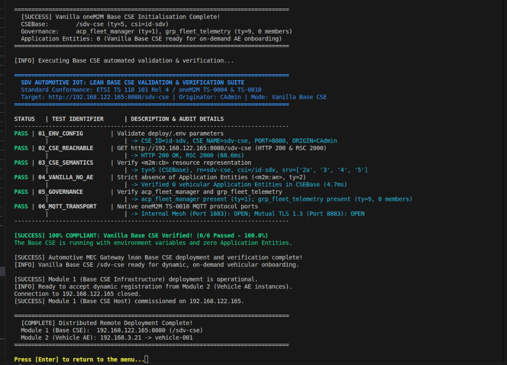

### 10.3 Failure Modes and Effects Analysis (FMEA) & Fault Injection Suite
The platform integrates an automated fault injection framework accessible via `make menu` option `[8]` or automated test scripts:

| Fault Mode Injected | System Reaction & Verification | Recovery Time | Fail-Safe State |
| :--- | :--- | :--- | :--- |
| **NDIR Sensor Disconnect** | Sensor serialises `co2_ppm: null`; classifier triggers `FAULT` within 1 cycle ($<1\text{ ms}$). | Instantaneous | Fan drops to safe baseline ($25\%$); Red LED active. |
| **Sensor Thermal Drift** | Artificially offsetting $T_{dht22}$ by $+2.0^\circ\text{C}$ forces $\Delta T > 1.5^\circ\text{C}$; state transitions to `DEGRADED`. | $< 1\text{ ms}$ | Continuous operation with diagnostic warning flag. |
| **Blower Mechanical Stall** | Tachometer pulses suppressed while $\text{PWM} \ge 30\%$; PCNT detects locked rotor; firmware cuts PWM to $0\%$. | $< 500\text{ ms}$ | Immediate motor drive shutdown; solid Red LED. |
| **MQTT Broker Severance** | Edge Client buffers frames in memory; reconnects automatically with zero data loss upon broker restoration. | $< 100\text{ ms}$ reconnect | Autonomous local FreeRTOS regulation on Micro-ECU. |
| **oneM2M Subscription Timeout**| Bridge AE notification queue alerts watchdog; container restarts if webhook unacknowledged for $>30\text{ s}$. | $< 5\text{ s}$ restart | Telemetry safely committed to InfluxDB directly. |

### 10.4 Requirements Traceability Matrix (RTM)

| Requirement ID | Requirement Summary | Architectural Module | Source Code Reference | Test Suite & Verification Case |
| :--- | :--- | :--- | :--- | :--- |
| **FR-PER-001** | Dual-channel $\text{CO}_2$/Temp/RH acquisition | Smart Cabin Node | [`firmware/esp32s3_cabin_node/main/scd30_driver.c`](file:///home/mosud/Documents/dev/HVAC-iot-monitoring/firmware/esp32s3_cabin_node/main/scd30_driver.c) | Bench Sensor Verification |
| **FR-PER-002** | Redundant DHT22 sensor cross-validation | Smart Cabin Node | [`firmware/esp32s3_cabin_node/main/dht22_driver.c`](file:///home/mosud/Documents/dev/HVAC-iot-monitoring/firmware/esp32s3_cabin_node/main/dht22_driver.c) | Bench Sensor Verification |
| **FR-PER-003** | Ultrasonic $25\text{ kHz}$ LEDC PWM modulation | Smart Cabin Node | [`firmware/esp32s3_cabin_node/main/pwm_fan_control.c`](file:///home/mosud/Documents/dev/HVAC-iot-monitoring/firmware/esp32s3_cabin_node/main/pwm_fan_control.c) | Oscilloscope Frequency Audit |
| **FR-PER-004** | Discrete coloured LED actuation suite | Smart Cabin Node | [`firmware/esp32s3_cabin_node/main/app_config.h`](file:///home/mosud/Documents/dev/HVAC-iot-monitoring/firmware/esp32s3_cabin_node/main/app_config.h) | Visual Inspection Testing |
| **FR-PER-005** | Tachometer PCNT stall detection | Smart Cabin Node | [`firmware/esp32s3_cabin_node/main/tachometer.c`](file:///home/mosud/Documents/dev/HVAC-iot-monitoring/firmware/esp32s3_cabin_node/main/tachometer.c) | Fault Injection Test |
| **FR-ING-001** | Dynamic USB serial discovery & fallback | Edge Serial Client | [`services/edge_client/src/serial_reader.py`](file:///home/mosud/Documents/dev/HVAC-iot-monitoring/services/edge_client/src/serial_reader.py) | Unit Test `test_edge_services.py` |
| **FR-ING-003** | Outbound JSON Schema validation | Edge Serial Client | [`services/edge_client/schemas/telemetry_schema.json`](file:///home/mosud/Documents/dev/HVAC-iot-monitoring/services/edge_client/schemas/telemetry_schema.json) | Unit Test `test_json_schema.py` |
| **FR-MID-001** | IPE protocol translation to oneM2M | Interworking Proxy | [`deploy/nodered/flows.json`](file:///home/mosud/Documents/dev/HVAC-iot-monitoring/deploy/nodered/flows.json) | Integration Test `test_e2e_pipeline.py` |
| **FR-MID-002** | oneM2M Release 4 semantic tree | ACME oneM2M CSE | [`deploy/onem2m/acme.ini`](file:///home/mosud/Documents/dev/HVAC-iot-monitoring/deploy/onem2m/acme.ini) | Validation `test_validate_base_cse.py` |
| **FR-INT-001** | 4-State Data Health Classification | Bridge AE Service | [`services/bridge_ae/src/health_classifier.py`](file:///home/mosud/Documents/dev/HVAC-iot-monitoring/services/bridge_ae/src/health_classifier.py) | Unit Test `test_health_classifier.py` |
| **FR-INT-002** | Non-coercive telemetry preservation | Bridge AE Service | [`services/bridge_ae/src/health_classifier.py`](file:///home/mosud/Documents/dev/HVAC-iot-monitoring/services/bridge_ae/src/health_classifier.py) | Unit Test `test_health_classifier.py` |
| **FR-INT-003** | InfluxDB 2.x persistence | Bridge AE Service | [`services/bridge_ae/src/influx_writer.py`](file:///home/mosud/Documents/dev/HVAC-iot-monitoring/services/bridge_ae/src/influx_writer.py) | InfluxDB Integration Query |
| **FR-ACT-001** | Downlink actuation dispatch | Actuator Controller| [`services/actuator_module/src/downlink_listener.py`](file:///home/mosud/Documents/dev/HVAC-iot-monitoring/services/actuator_module/src/downlink_listener.py)| Integration Test `test_e2e_pipeline.py` |
| **FR-WDM-001** | Web Operations Cockpit & APIs | Web Portal & Grafana| [`services/web_portal/app.py`](file:///home/mosud/Documents/dev/HVAC-iot-monitoring/services/web_portal/app.py) | Web Portal Unit Test `test_web_portal.py` |
| **FR-TUI-001** | Interactive deployment & diagnostic TUI with automated passwordless SSH provisioning and pre-flight audits | Terminal Dashboard | [`deploy/menu.sh`](file:///home/mosud/Documents/dev/HVAC-iot-monitoring/deploy/menu.sh) & [`scripts/check_install-docker_ssh.sh`](file:///home/mosud/Documents/dev/HVAC-iot-monitoring/scripts/check_install-docker_ssh.sh) | Usability, SSH Key & Pre-flight Walkthrough |

---

## 11. Project Provenance, Academic Attribution, and Normative References

### 11.1 Academic Provenance and Research Team
This cyber-physical systems engineering specification suite represents the collective research output of **Group MIO3B** within the **Department of Electronic Engineering and Entrepreneurship** at the **University of Applied Sciences Technikum Wien (FH Technikum Wien)**.

- **Project Researchers:** **Isiaka Mosudi**, **Ashok Ramalingam**, **Pooja Janwalkar**
- **Research Team Members:** **AnnaMaria Moçi**, **Julia Philip**
- **Degree Programme:** Master of Science in Engineering in IoT and Intelligent Systems (MIO)
- **Academic Course:** Advanced Internet of Things Systems Development
- **Research Cluster:** Distributed Cyber-Physical Systems and Automotive IoT (FHTW-AIOT)
- **GitHub Repository:** [https://github.com/imosudi/HVAC-iot-monitoring](https://github.com/imosudi/HVAC-iot-monitoring)

### 11.2 CRediT Contributor Attribution
Adhering to the **Contributor Roles Taxonomy (CRediT)** standard:

- **Isiaka Mosudi** (*Conceptualisation, Methodology, System Architecture, Middleware, Orchestration*): End-to-end cyber-physical systems architecture, oneM2M semantic resource model design, ACME CSE integration, Node-RED Interworking Proxy Entity (IPE) flows, Docker containerisation, interactive terminal operations dashboard ([`deploy/menu.sh`](file:///home/mosud/Documents/dev/HVAC-iot-monitoring/deploy/menu.sh) / `make menu`), and project orchestration.
- **Ashok Ramalingam** (*Software, Hardware, Embedded Firmware, Edge Security*): Embedded FreeRTOS firmware implementation, SCD30 and DHT22 hardware driver engineering, 25 kHz LEDC PWM blower frequency design, tachometer pulse counter configuration, optical telemetry signalling, and mutual TLS 1.3 client integration.
- **Pooja Janwalkar** (*Software, Data Persistence, Observability, Telemetry Analytics*): InfluxDB 2.x time-series database architecture, Flux query formulation, continuous data health state machine modelling, Grafana enterprise dashboard provisioning, and historical analytical reporting.
- **AnnaMaria Moçi** (*Validation, Verification, Testing, Quality Assurance*): Test pyramid formulation, unit testing, integration pipeline scripting, empirical latency benchmarking, and requirements traceability matrix auditing.
- **Julia Philip** (*Formal Specification, Standards Compliance, Documentation, UX*): System requirements specification, ETSI oneM2M standard compliance auditing, technical documentation synthesis, and web portal UX/UI evaluation.

### 11.3 Standards, Normative References, and Bibliography
1. **ETSI TS 118 101 Rel 4:** *oneM2M Functional Architecture.* European Telecommunications Standards Institute.
2. **oneM2M TS-0001:** *Functional Architecture.* oneM2M Partnership Project.
3. **oneM2M TS-0003:** *Security Solutions.* oneM2M Partnership Project.
4. **oneM2M TS-0004:** *Service Layer Core Protocol Specification.* oneM2M Partnership Project.
5. **oneM2M TS-0010:** *MQTT Protocol Binding.* oneM2M Partnership Project.
6. **IETF RFC 8446:** *The Transport Layer Security (TLS) Protocol Version 1.3.* Internet Engineering Task Force.
7. **IETF RFC 5280:** *Internet X.509 Public Key Infrastructure Certificate and Certificate Revocation List (CRL) Profile.* IETF.
8. **IEEE Std 29148-2018:** *Systems and Software Engineering — Life Cycle Processes — Requirements Engineering.* IEEE Computer Society.
9. **ISO/IEC/IEEE 42010:2022:** *Software, Systems and Enterprise — Architecture Description.* ISO/IEC/IEEE.
10. **ETSI GS MEC 003:** *Multi-Access Edge Computing (MEC); Framework and Reference Architecture.* ETSI.

---
*End of Engineering Specification Suite — Software-Defined Vehicle (SDV) Cyber-Physical Cabin Environmental Monitoring and Closed-Loop HVAC Regulation System*
